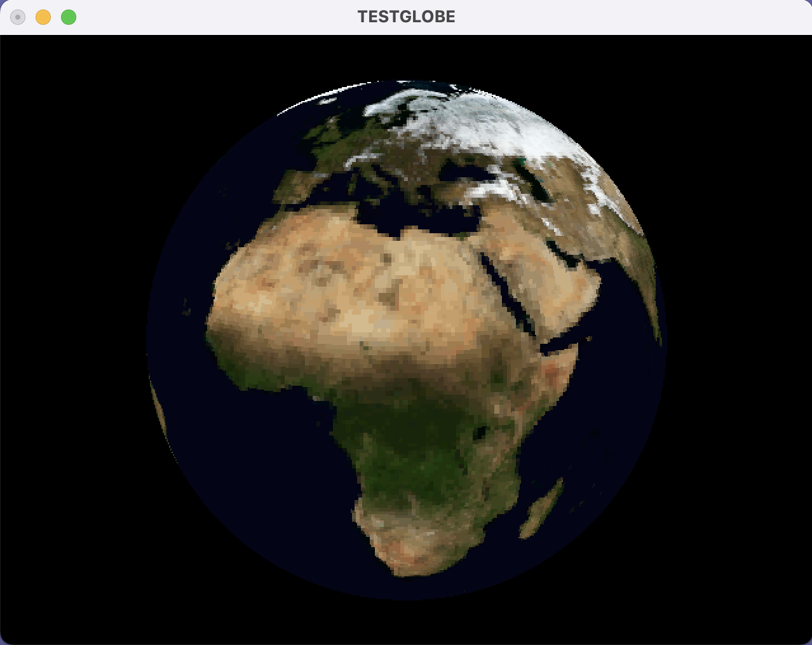

# testglobe

[Website](https://testglobe.dev) | [Repository](https://github.com/trguhq/testglobe/) | [WebGL demo](https://testglobe.dev/web/)

testglobe draws a rotating 3D globe through many graphics APIs and hardware,
especially systems from the late 1980s and early 1990s. It compares flat shading,
which gives each triangle or quad one Earth-map color, with texture mapping, which
samples the map across it. Texture mapping starts disabled; higher resolutions use
more memory and rendering time.

OpenGL is the original backend. The other backends and later changes include
AI-generated code. They have host regression coverage, but native validation on
their target systems is still pending; see [Testing](#testing).



*OpenGL driver running on macOS*

[Video: testglobe on a Sun Ultra 60 with Elite3D-m6 graphics](https://www.youtube.com/watch?v=CffPcvwioUA)

## Drivers

Earth maps store 8-bit palette indices. OpenGL and IRIS GL use them in RGB(A) or
color-index windows, and Sun XGL expands them to RGB. Matrox LibShell, TIGA, Windows
GDI, and QuickDraw draw through the Earth palette. Amiga maps the colors to
Workbench pens or a private fullscreen palette, or draws RGB on truecolor RTG screens.

| Driver | Platform | Build | Default globe | Texture |
| --- | --- | --- | --- | --- |
| [WebGL](docs/webgl.md) | Modern browsers with WebGL 2 | None | Key 5: 512 × 256 | Yes |
| [OpenGL](docs/opengl.md) | Linux, Unix, and modern macOS | `make opengl`, `solaris-opengl`, or `apple-opengl` | Key 5: 512 × 256 | Yes |
| [Amiga OpenGL](docs/opengl.md#amiga-opengl) | AmigaOS 3.x, 68020/68881, PiStorm3D / MiniGL | `make amiga-opengl` | Key 5: 512 × 256 | Yes |
| [IRIS GL](docs/irisgl.md) | IRIX 4.0, 32-bit MIPS | `make irisgl` | Key 3: 128 × 64 | Yes |
| [Sun XGL](docs/xgl.md) | Solaris 2.6, 32-bit SPARC | `make xgl` | Key 3: 128 × 64 | Yes |
| [Matrox LibShell and PGC](docs/matrox.md) | MS-DOS, Matrox PG Series 1 running the LIB Shell, or an IBM PGC-compatible board such as the Matrox PG-640A | `nmake matrox` | Key 1: 32 × 16 | No |
| [TIGA](docs/tiga.md) | MS-DOS, TIGA 2.x, 640 × 480 indexed color | `nmake tiga` | Key 1: 32 × 16 | No |
| [Windows GDI](docs/gdi.md) | Windows 3.0 or 3.1, 16-bit | `nmake gdi` | Key 1: 32 × 16 | No |
| [QuickDraw](docs/quickdraw.md) | Classic Macintosh System 7, 68000 | MPW `Makefile.mpw` | Key 1: 32 × 16 | No |
| [Amiga](docs/amiga.md) | AmigaOS Workbench, 68000 and later, OCS/ECS/AGA or RTG | `make amiga` | Key 1: 32 × 16 | No |

## Quick start

To try it without building anything, open the [WebGL demo](https://testglobe.dev/web/).
To build and run the desktop OpenGL version on Linux or Unix (Debian/Ubuntu package
shown):

```sh
sudo apt-get install freeglut3-dev libxmu-dev
make
./testglobe-opengl
```

The Makefiles work with traditional make, IRIX and Solaris make, and Microsoft NMAKE;
GNU make is not required. [Building](docs/build.md) lists every target, out-of-tree
builds, cleaning, the Linux-hosted cross-builds for DOS, Windows 3.x, and System 7,
and how the Earth maps are embedded. Each driver page gives its requirements and
build variables.

## Controls

Letter keys work in either case.

| Input | Action |
| --- | --- |
| `1`–`5` | Select globe resolution (maps 32 to 512 pixels wide); Matrox and TIGA support only `1` and `2`. |
| Left mouse drag | Rotate the globe; WebGL also supports touch dragging. |
| `a` | Toggle automatic rotation. |
| `f` | Toggle FPS measurement; in the chipset/RTG Amiga driver, toggle fullscreen instead. |
| `p` | Toggle FPS measurement in the chipset/RTG Amiga driver. |
| `o` | Toggle the on-screen display (OSD). |
| `t` | Toggle texture mapping in OpenGL, IRIS GL, Sun XGL, and WebGL. |
| `c` | Toggle CPU culling of back-facing latitude-band ranges in OpenGL, IRIS GL, Sun XGL, and WebGL; on by default in Sun XGL only. |
| `d` | Toggle display lists in OpenGL, or palette dithering in the native Amiga driver; both start enabled. |
| `s` | Switch Matrox or TIGA between host software transforms and board/API transforms. Matrox starts with board transforms (LibShell or PGC), TIGA with host transforms. |
| `Esc` | Exit native applications (Matrox and TIGA also accept Ctrl-C and Ctrl-Break); in WebGL, pause rotation and release dragging. |

WebGL also has on-screen controls and a **Reset view** button.

The OSD shows the polygon count, frame rate, and the state of each toggle, for example
`texture on`, `texture fail`, or `cull off`. [Controls and status](docs/usage.md)
explains every status message, how FPS is measured, window and font sizing, CPU
culling, and how drivers recover from memory or resource shortages.

## Downloads

The [v0.1 release](https://github.com/trguhq/testglobe/releases/tag/v0.1) provides
OpenGL binaries for IRIX (MIPS IV), Linux (ARM64), macOS (x86-64 and ARM64), and
Solaris (SPARCv8).

Development builds of 0.2.2 are in the [`downloads`](downloads/README.md) folder:

| Application | Download |
| --- | --- |
| DOS Matrox LibShell and IBM PGC | [testglobe-matrox-0.2.2.zip](https://github.com/trguhq/testglobe/raw/refs/heads/develop/downloads/testglobe-matrox-0.2.2.zip) |
| DOS TIGA | [testglobe-tiga-0.2.2.zip](https://github.com/trguhq/testglobe/raw/refs/heads/develop/downloads/testglobe-tiga-0.2.2.zip) |
| Windows 3.0 and 3.1 GDI | [testglobe-gdi-0.2.2.zip](https://github.com/trguhq/testglobe/raw/refs/heads/develop/downloads/testglobe-gdi-0.2.2.zip) |
| System 7 QuickDraw, 68000 | [testglobe-quickdraw-0.2.2.zip](https://github.com/trguhq/testglobe/raw/refs/heads/develop/downloads/testglobe-quickdraw-0.2.2.zip) (MacBinary file and 800 KiB HFS disk image) |
| Amiga chipset / RTG | [testglobe-amiga-0.2.2.zip](https://github.com/trguhq/testglobe/raw/refs/heads/develop/downloads/testglobe-amiga-0.2.2.zip) |
| Amiga PiStorm3D (MiniGL) | [testglobe-amiga-opengl-0.2.2.zip](https://github.com/trguhq/testglobe/raw/refs/heads/develop/downloads/testglobe-amiga-opengl-0.2.2.zip) |

Each archive includes installation notes, a license, and checksums; see the
[downloads notes](downloads/README.md). The DOS and Windows applications embed their
data in `testglob.exe`. Decode the Macintosh
MacBinary file with a resource-fork-aware utility, or use the disk image.

## Testing

Run the host regression checks from the repository root:

```sh
python3 tests/run.py
```

They compile the production code with host call recorders and sanitizers, and check
data, geometry, API arguments, input, and resource handling. They do not establish
historical binary compatibility or real graphics output; each driver page lists what
still needs native validation. [Testing](docs/testing.md) covers the optional driver
checks, the WebGL tests, and their requirements. Native builds do not need the Python
test runner.

## Documentation

- [Controls and status](docs/usage.md): OSD messages, FPS, fonts, culling, recovery,
  and exiting.
- [Building](docs/build.md): targets, build settings, cross-builds, and Earth map data.
- Drivers: [WebGL](docs/webgl.md), [OpenGL and Amiga OpenGL](docs/opengl.md),
  [IRIS GL](docs/irisgl.md), [Sun XGL](docs/xgl.md), [Matrox LibShell and PGC](docs/matrox.md),
  [TIGA](docs/tiga.md), [Windows GDI](docs/gdi.md), [QuickDraw](docs/quickdraw.md),
  and [Amiga](docs/amiga.md).
- [Testing](docs/testing.md): host checks, driver contract tests, and their limits.
- [Development notes](docs/development.md): source layout, driver interface, geometry
  submission, and shared rendering pipelines.

## Planned work

- Elevation.
- Real-time sunlight.
- Real-time clouds, if feasible.
- Shadows.
- City lights.
- A one-button benchmark.
- Other possible backends: IBM Adapter Interface and VBE/AF.

## Version history

### v0.2.x (in development)

- Added Matrox LibShell and PGC, TIGA, Windows GDI, QuickDraw, Sun XGL, IRIS GL, and Amiga
  backends.
- Added a static WebGL 2 browser frontend using the canonical Earth maps and palette.
- Embedded the canonical binary Earth maps through bounded C arrays or native
  resources, with disposable build sources and a supplied fallback copy..
- Added FPS, automatic rotation, display-list control, and texture-use status.
- Added selectable host/TI transforms and DOS CPU/FPU dispatch for TIGA, and embedded
  the TI transform module for single-executable distribution.
- Hardened allocation, file generation, coordinate and packet bounds, input recovery,
  and driver error handling; reduced retained rendering memory.
- Converted comments to C style and fixed bitmap OSD text in Mesa.

### [v0.1](https://github.com/trguhq/testglobe/releases/tag/v0.1)

First release, with OpenGL/GLUT and binaries for several platforms.

## License

GNU General Public License, version 3 or later. See [LICENSE](LICENSE).
