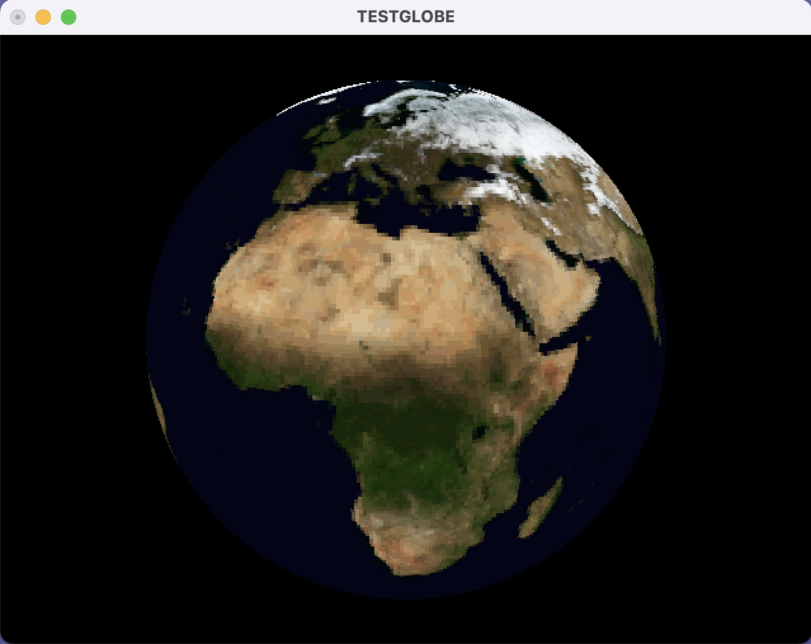

# testglobe

[Website](https://testglobe.dev) | [Repository](https://github.com/trguhq/testglobe/)

testglobe displays a 3D globe through different graphics APIs and hardware, with an
emphasis on systems from the late 1980s and early 1990s. It compares detail from
flat-shaded polygons with detail from texture mapping: flat shading assigns each
triangle or quad an Earth-map color, while texturing samples the map across it.
Texture mapping starts disabled. Higher resolutions use more memory and rendering time.

OpenGL is the original backend. The additional backends and subsequent changes include
AI-generated code. These experimental backends have host regression coverage; native
validation remains pending. See [Testing and validation](#testing-and-validation) for
the distinction between host checks and native rendering.



*OpenGL driver running on macOS*

[Video: testglobe on a Sun Ultra 60 with Elite3D-m6 graphics](https://www.youtube.com/watch?v=CffPcvwioUA)

## Contents

- [Current drivers](#current-drivers)
- [Controls and status](#controls-and-status)
- [Binary releases](#binary-releases)
- [Build instructions](#build-instructions)
- [Testing and validation](#testing-and-validation)
- [Development notes](#development-notes)
- [Planned work](#planned-work)
- [Version history](#version-history)
- [License](#license)

## Current drivers

Earth maps store 8-bit palette indices. OpenGL and IRIS GL use those indices in either
RGB(A) or color-index windows; Sun XGL expands them to RGB. Matrox LibShell, Windows
GDI, and QuickDraw draw through the Earth palette.

| Driver | Platform | Default globe | Texture toggle |
| --- | --- | --- | --- |
| [OpenGL](#opengl) | Linux, Unix and modern macOS | Key 5: 512 × 256 | Yes |
| [IRIS GL](#iris-gl) | IRIX 4.0, 32-bit MIPS | Key 3: 128 × 64 | Yes |
| [Sun XGL](#sun-xgl) | Solaris 2.6, 32-bit SPARC | Key 3: 128 × 64 | Yes |
| [Matrox LibShell](#matrox-libshell) | MS-DOS, PG-641-compatible hardware | Key 1: 32 × 16 | No |
| [Windows GDI](#windows-gdi) | Windows 3.1, 16-bit | Key 1: 32 × 16 | No |
| [QuickDraw](#quickdraw) | Classic Macintosh System 7, 68000 | Key 1: 32 × 16 | No |

## Controls and status

Letter controls accept either case.

| Input | Action |
| --- | --- |
| `1`–`5` | Select globe resolution; Matrox LibShell supports only `1` and `2`. |
| Left mouse drag | Rotate the globe. |
| `a` | Toggle automatic rotation. |
| `f` | Toggle FPS measurement and its on-screen statistic. |
| `o` | Toggle the on-screen display (OSD). |
| `t` | Toggle texture mapping in OpenGL, IRIS GL, and Sun XGL. |
| `d` | Toggle display lists in OpenGL; enabled by default. |
| `Esc` | Exit. |

Keys `1`–`5` select maps 32, 64, 128, 256, and 512 pixels wide (`EARTH_32` through
`EARTH_512`); map height is half the width. The OSD counts quad patches for Matrox,
GDI, and QuickDraw, and triangles for the other drivers. Pole patches count as quads
even when coincident vertices collapse to a triangle for drawing.

Console builds print the globe resolution, vertex count, and triangle or quad count
after each successful mesh construction. Failed attempts and selecting the current
resolution do not repeat these messages. GDI and QuickDraw use their native OSD.

Matrox, GDI, and QuickDraw also report polygons retained after software culling.
The other drivers report totals because native culling supplies no visibility count.
FPS starts enabled; turning it off leaves rotation timing active. FPS measures the
interval between completed presentations, including event-loop waits. It is an
interactive frame rate, not a synchronized GPU throughput benchmark; native swap
and flush calls provide different completion guarantees. Scene and rendering-mode
changes restart the sample.

| Status | Meaning |
| --- | --- |
| `texture on` | The frame uses the graphics API's texturing path; this does not guarantee hardware acceleration. |
| `texture soft` | OpenGL or IRIS GL uses the application's software texture rasterizer. |
| `texture off` | Texture mapping is disabled. |
| `texture fail` | Texturing is enabled but a detected failure prevents its use; recoverable failures draw flat colors. |
| `dlist on` | OpenGL successfully uses a display list for the current frame. |
| `dlist off` | Display lists are disabled. |
| `dlist fail` | Lists are enabled but unavailable, failed, or bypassed. |
| `GWorld on` / `GWorld off` | QuickDraw is drawing through an offscreen GWorld / directly to the window. |

Toggle `t` off and on to retry after a recoverable texture failure. OpenGL software
texturing bypasses display lists, so enabled lists report `dlist fail` on that path.
XGL's internal software pipeline still reports `texture on`; IRIS GL cannot detect
all silent native texture failures. Their driver sections describe these limits.
OpenGL places `dlist` after FPS and before texture status, with its `d` help last.
QuickDraw appends GWorld status after the other statistics.
When a smaller texture is active, its width follows the status, for example
`texture on (128)` or `texture soft (128)`. GDI reports direct drawing, individual
polygons, reduced colors, or manual rotation when those fallbacks are active.

On displays of 640 × 480 or smaller, GDI and QuickDraw default to a 320 × 240 client
area; larger displays use 640 × 480. Explicit size requests are preserved, with
QuickDraw clamping its window to the selected screen.

### Resource recovery

Selecting the current resolution does not rebuild the mesh. When a new mesh cannot
be allocated, optional rendering caches are released before retrying. The application
can restore the previous resolution or select a smaller supported level; startup uses
the same lower-resolution fallback. The OSD identifies the active result and any
recovery notice. A scene that still cannot be built leaves a responsive empty window
so another resolution can be selected. Bad data and invalid requests remain distinct
from insufficient memory.

Insufficient texture memory or a queried native size limit can reduce the image from
512 through 256, 128, 64, and 32 pixels wide. Other native errors are not assumed to
be memory shortages. If no usable texture can be created, the request remains enabled
while flat colors are drawn and `texture fail` is reported. Geometry caches and large submission
packets are optional: direct drawing or smaller packets preserve the same globe.
Fallback resolution, texture size, buffering, and cache use affect performance, so
compare runs using the actual reported settings.

These fallbacks preserve usable native rendering resources. Selecting another valid
resource can recover from bad map data, but does not repair the damaged resource.
A lost device or an opaque native-library error can still require shutdown.

## Binary releases

The [v0.1 release](https://github.com/trguhq/testglobe/releases/tag/v0.1) provides
OpenGL binaries for these platforms:

| Operating system | Architecture |
| --- | --- |
| IRIX | MIPS IV |
| Linux | ARM64 |
| macOS | x86-64 / ARM64 |
| Solaris | SPARCv8 |

## Build instructions

The portable Makefiles use plain macro assignments and explicit rules shared by
traditional Unix/System V make, IRIX/Solaris make, and Microsoft NMAKE. GNU make is not
required. Run the following commands from the repository root or `src`, with the
appropriate platform's compiler and libraries installed:

| Target | Command | Output |
| --- | --- | --- |
| [OpenGL](#opengl) (default) | `make` or `make opengl` | `testglobe-opengl` |
| [Solaris OpenGL](#solaris-solaris-opengl) | `make solaris-opengl` | `testglobe-opengl` |
| [Apple OpenGL](#modern-macos-apple-opengl) | `make apple-opengl` | `testglobe-opengl` |
| [IRIS GL](#iris-gl) | `make irisgl` | `testglobe-irisgl` |
| [Sun XGL](#sun-xgl) | `make xgl` | `testglobe-xgl` |
| [Matrox LibShell](#matrox-libshell) | `nmake matrox` | `testglob.exe` |
| [Windows GDI](#windows-gdi) | `nmake gdi` | `testglob.exe` |
| [QuickDraw](#quickdraw) (MPW bridge) | `make quickdraw` | `TestglobeQD` |

Native MPW users build QuickDraw with `Makefile.mpw` as described in its section. The
portable `quickdraw` target requires a configured bridge to the MPW tools.

### Common build settings

Objects and executables are written in the directory where make runs. For an
out-of-tree build, create a build directory, enter it, then run:

```sh
make -f /path/to/testglobe/src/Makefile SRC=/path/to/testglobe/src
```

Append the desired target, such as `apple-opengl`. OpenGL's three targets share
`testglobe-opengl`; Matrox and GDI share `testglob.exe`. Selecting a target relinks its
executable. Driver objects have separate names, so the Unix backends can coexist.

Traditional make does not track compiler-option changes. Clean the affected objects
before changing the compiler or build flags:

| Command | Removes |
| --- | --- |
| `make clean` | All build objects, generated build sources, temporary files, and application/helper binaries. |
| `make clean-<target>` | That backend's objects, executable, and backend-specific intermediates. Shared data sources and helpers generally remain. |
| `make clean-earth-data` | Generated `e_data.c`/`m_data.c`, converter binaries, and data-generation temporary files. |

Individual targets are `clean-opengl`, `clean-solaris-opengl`, `clean-apple-opengl`,
`clean-irisgl`, `clean-xgl`, `clean-matrox`, `clean-gdi`, and `clean-quickdraw`.
Under DOS use `nmake` with `RM=del`, for example `nmake clean RM=del`. Cleanup preserves
the supplied `src/e_saved.c`, canonical binary maps, and recovery `.bak` files.

Each build section lists its compiler and flag variables. The default Unix
`SYS_FLAGS=-DNO_SINF -DNO_GENMIPMAP` selects C89 `sin`/`cos` and GLU mipmaps for older
libraries. Apple OpenGL uses separate `APPLE_SYS_FLAGS` and the modern system math
library. See [OpenGL platform notes](#opengl-platform-notes) for optional mipmap support.

`DEBUG` defaults to `0`. After cleaning, use `make opengl CPPFLAGS=-DDEBUG=1` to enable
pixel-storage and right-button diagnostics. A System 7 single-button mouse has no
separate right-button state. Software texture buffers are released when texturing is
disabled; `CPPFLAGS=-DTEXTURE_CACHE_RASTER=1` retains them instead. Use the corresponding
CPPFLAGS variable for other targets. [Development notes](#shared-rendering-pipelines)
describe the cache and memory policy.

### Earth map data

Each application embeds its selected Earth maps and needs no external data files at
runtime. Preserve binary bytes when transferring the project; preserve QuickDraw's
application resource fork when copying its executable.

| File | Role |
| --- | --- |
| `data/*.bin` | Canonical 8-bit Earth palette indices; edit these to change map data. |
| `src/e_bin.c` | Build-time converter for Unix and DOS. |
| `e_data.c` / `m_data.c` | Disposable generated C source in the Unix / DOS build directory. |
| `src/e_saved.c` | Supplied generated copy for manual builds; normal builds generate their own source. |
| `src/e_cmap.h` | Earth color palette. |
| `src/earthres.h` | Shared chunk size and native resource IDs. |
| `src/gdi.rc` / `src/qd.r` | Embed binary chunks as Windows `RCDATA` / Macintosh `EART` resources. |

| Map width | Binary inputs | Total bytes |
| --- | --- | --- |
| 32 | `e32.bin` | 512 |
| 64 | `e64.bin` | 2,048 |
| 128 | `e128.bin` | 8,192 |
| 256 | `e256_0.bin`, `e256_1.bin` | 32,768 |
| 512 | `e512_0.bin` through `e512_7.bin` | 131,072 |

OpenGL, IRIS GL, Sun XGL, and Matrox compile generated arrays of at most 16 KiB.
Driver `EARTH_*` defines select the maps included in each executable; Matrox includes
only the 32- and 64-wide maps. GDI and QuickDraw embed all maps as native resources.
The five maps total 170.5 KiB; Matrox's two maps total 2.5 KiB. Generated and saved
source files are build copies, not additional runtime map allocations. Compiled-data
paths borrow bounded read-only map spans. GDI and QuickDraw load selected chunks
directly into the final owned index buffer; neither retains a second full source map.

Make regenerates build source when missing or when an input changes. `EARTH_DATA`
(Unix) and `MTX_DATA` (DOS) select the input directory, defaulting to `data` beside
`SRC`. `EARTH_CC` and `EARTH_CFLAGS` select the Unix converter compiler and options;
DOS uses the Matrox compiler settings.

| Task | Command |
| --- | --- |
| Refresh the supplied copy after changing binary inputs | `make earth-data` or `nmake earth-data-dos` |
| Remove build copies and converter tools | `make clean-earth-data` or `nmake clean-earth-data RM=del` |

The next application build regenerates removed source. For manual builds, compile
`src/e_saved.c` instead of the build copy; do not link both. The supplied copy was
formerly named `src/e_data.c`, so older manual compile commands need that filename change.

The converter rejects input/output aliases, nonregular destinations, occupied
`.tmp`/`.bak` paths, and Unix symbolic-link outputs. After an interrupted replacement,
keep any `.bak` until the output is verified or restored. Changing the chunk size also
requires resplitting the binaries and updating generator/resource tables; a compile-time
guard rejects stale generated readers.

### OpenGL

#### Requirements

OpenGL 1.1, GLU, and GLUT are required, with a legacy or compatibility context. On
Debian or Ubuntu, install the development libraries with:

```sh
sudo apt-get install freeglut3-dev
```

Archived Solaris GLUT packages are available for
[32-bit SPARC](https://web.archive.org/web/20010726175006/http://reality.sgi.com/opengl/glut3/glut-3.7b.sparc_solaris.tar.gz)
and
[64-bit SPARC](https://web.archive.org/web/20010726192034/http://reality.sgi.com/opengl/glut3/glut-3.7b.sparc_solaris_64.tar.gz).
Modern macOS uses Apple's frameworks.

#### Build

##### Unix build (`opengl`)

```sh
make opengl
./testglobe-opengl
```

The default compiler is `cc` with `-O`. Override `CC`, `CPPFLAGS`, `CFLAGS`, `SYS_FLAGS`,
and `LDFLAGS` for the installed compiler and libraries.

##### Solaris (`solaris-opengl`)

Use the Solaris C compiler, OpenGL/GLU, GLUT, and OpenWindows libraries:

```sh
make solaris-opengl
./testglobe-opengl
```

`SOLARIS_CC` defaults to `CC`; `SOLARIS_CFLAGS` defaults to `CFLAGS`.
`OPENWINHOME=/usr/openwin` selects headers, libraries, and the runtime search path.
Override `SOLARIS_CPPFLAGS`, `SOLARIS_SYS_FLAGS`, and `SOLARIS_LDFLAGS` as needed.
The compiler's default architecture and ABI are retained.

The equivalent library settings for the generic target are:

```sh
make opengl CC=cc CPPFLAGS=-I/usr/openwin/include \
  LDFLAGS="-L/usr/openwin/lib -R/usr/openwin/lib -lglut -lGL -lGLU -lX11 -lXmu -lm"
```

##### Modern macOS (`apple-opengl`)

Use the selected Xcode Command Line Tools and their macOS SDK:

```sh
make apple-opengl
./testglobe-opengl
```

This target links `-framework GLUT -framework OpenGL -framework Cocoa`; GLU comes
from `OpenGL.framework` and math functions from the system runtime. No Homebrew or
XQuartz installation is needed. The selected toolchain supplies Intel or Apple silicon
architecture and SDK defaults.

`APPLE_CC` defaults to `CC` (`cc`, normally Apple's Clang); `APPLE_CFLAGS` defaults to
`CFLAGS`. Override `APPLE_CPPFLAGS`, `APPLE_SYS_FLAGS`, and `APPLE_LDFLAGS` as needed.
The default `APPLE_SYS_FLAGS=-DNO_GENMIPMAP -DGLUT_SILENCE_DEPRECATION` selects GLU
mipmaps and suppresses GLUT deprecation warnings. Apple builds use `<GLUT/glut.h>`.

#### Rendering and color

Each interior latitude band uses a triangle strip; both polar caps share one batch of
nondegenerate triangles. Flat colors, winding, and texture seams match the independent
triangle path. The default globe is key 5. Display lists cache native geometry and
start enabled; disabling them deletes the cache, while enabling them rebuilds it on
the next native frame. See [Controls and status](#controls-and-status).

The driver probes RGBA, RGB, and color-index formats with single/double-buffer and
depth-buffer alternatives. It prefers RGB(A) over color index, then greater total
RGB-plus-alpha precision before buffering. Requests include 8/8/8/8, 8/8/8, 5/6/5,
5/5/5, unconstrained RGB(A), and color index with at least eight bits. GLUT probes do
not enumerate every native visual; older implementations may expose fewer choices.
Classic GLUT RGB fallbacks do not require an alpha channel.

When GLUT lacks `GLUT_DISPLAY_MODE_POSSIBLE`, the driver makes the original single
RGB, double-buffered window request and reads the resulting window attributes.
It cannot safely probe alternative formats on those implementations: an unsupported
request may terminate GLUT instead of returning a failure.

Flat shading retains each Earth palette byte, converting it to RGB for RGB(A) windows
or submitting the index directly. Color-index windows use the shared software texture
rasterizer because classic OpenGL texturing requires RGB(A) mode. That path bypasses
display lists.

#### Platform notes

<a id="opengl-platform-notes"></a>

Display-list allocation, compilation, validation, and execution are checked with
OpenGL 1.1 calls, including `glIsList` and `glGetError`. A failed cache is discarded and
geometry is drawn immediately. Texture-memory shortages and native size limits try
smaller images; other texture failures release failed resources and draw flat colors.
Failed lists are not rebuilt every frame or on resolution changes; toggling `d` or
`t` explicitly permits a retry.
Diagnostics use `glGetError`, without modern debug extensions.

All three targets default to GLU mipmaps. Omitting `NO_GENMIPMAP` permits an optional
path when FreeGLUT 2.0 or later headers are available: the running context must report
OpenGL 3.0 or later, `glGenerateMipmap` must resolve at runtime, and the image must fit
the texture limit. Otherwise the driver uses `gluBuild2DMipmaps`. No post-1.1 OpenGL
symbol is required at link time, and `GL_GLEXT_PROTOTYPES` is unnecessary.

#### Validation

See the [OpenGL host checks](tests/README.md#opengl). Physical color-index behavior
requires an implementation offering that visual. Native Apple SDK compilation and
rendering require macOS; Solaris builds require its installed graphics libraries.

### IRIS GL

#### Requirements

Use native 32-bit MIPS IRIX 4.0 with the IRIS GL development headers and runtime.
Windowing, input, and rendering use IRIS GL directly.

#### Build

```sh
make irisgl
./testglobe-irisgl
```

`IGL_CC` defaults to `CC`; override `IGL_CPPFLAGS`, `IGL_CFLAGS`, `IGL_SYS_FLAGS`, and
`IGL_LDFLAGS` for the installed tools. Defaults select `FLAT`, `DRV_IGL`, C89 math,
and `-lc_s -lgl_s -lm`, following the IRIS GL Programming Guide's shared-library
example. No later MIPS ISA or ABI is imposed.

#### Rendering and color

The default globe is key 3. IRIS GL performs model/view transforms, 45-degree
perspective, clipping, triangle-mesh drawing, back-face rejection, and bitmap-font
OSD. Geometry is cached in a GL object and rebuilt for resolution or texture changes.
If the object cannot be allocated or validated, the driver draws the same geometry
directly and retains the user's requested rendering settings.
Interior bands use `bgntmesh`/`endtmesh`; polar caps use three-vertex meshes.

Runtime queries compare single- and double-buffered RGB(A) formats, preferring total
channel precision, then alpha and RGB precision, then double buffering. If RGB is
unavailable, the driver selects the largest color-index mode with at least eight bits.
Flat colors retain the Earth index and convert to RGB when needed. Color-index mode
installs the Earth palette and restores it at exit. A z-buffer is used when available;
the convex globe can also be drawn with back-face rejection alone.

Native texturing uses `texdef2d`, `t2f`, mipmaps, and bilinear filtering. When unavailable,
the shared software rasterizer draws the textured globe using matrices supplied by
IRIS GL, then presents the image through IRIS GL. Flat rendering remains native.

#### Platform notes

The event queue supplies keyboard, drag, resize, focus, and close events. Interrupted
tied mouse samples and queue overflow resample mouse state without blocking on missing
samples or discarding later keyboard/close events.

Texture definition, binding, and pixel-transfer calls return no success value. The
driver detects allocation failures, missing data, and lost texture capability, but
cannot confirm silent failures inside the native library. Consequently, `texture on`
means native submission for that frame. Recoverable failures discard failed state and
cached geometry before drawing flat colors.

#### Validation

See the [IRIS GL host checks](tests/README.md#iris-gl). Native validation must cover
the IRIX 32-bit ABI, graphics hardware, fonts, window manager, and pixel transfer.

### Sun XGL

#### Requirements

Use 32-bit SPARC Solaris 2.6 with Sun XGL 3.x, X11/OpenWindows, and a 24-bit TrueColor
visual. The driver uses Xlib directly.

#### Build

```sh
make xgl
./testglobe-xgl
# For nonstandard SDK locations:
make xgl XGLHOME=/path/to/xgl OPENWINHOME=/path/to/openwin
```

Defaults are `/opt/SUNWits/Graphics-sw/xgl` and `/usr/openwin`. Override
`XGL_CPPFLAGS`, `XGL_CFLAGS`, `XGL_SYS_FLAGS`, and `XGL_LDFLAGS` as needed; the native
compiler's 32-bit default is used. When relocating the runtime, also set the shell's
`XGLHOME` for the installed pipeline and font files.

#### Rendering and color

The default globe is key 3. Each interior latitude band uses `xgl_triangle_strip`;
polar caps use nondegenerate three-vertex strips. Both triangles of each Earth patch
share its flat RGB color. XGL performs transforms, clipping, back-face handling,
depth testing, and texturing. Texture mapping uses REPLACE mode and preserves UV seams.
X11 handles keyboard, mouse, expose, resize, and window-close events.

#### Platform notes

XGL supplies its own software pipeline when hardware cannot accelerate texturing.
Because the API exposes no reliable per-frame backend query, successful texturing
reports `texture on` for either internal path. Recoverable texture failures release
partial resources and draw flat colors. Nonrecoverable errors and unrelated setup,
native rendering, or OSD errors remain fatal. Native texture rasters are filled from
indexed map rows without an intermediate full RGB image. Packet allocation failures
use smaller strips, retaining overlap, winding, colors, and UVs.

#### Validation

See the [Sun XGL host checks](tests/README.md#sun-xgl). Native SDK compilation, ABI
compatibility, and physical rendering require the Sun SDK/runtime on Solaris.

### Matrox LibShell

#### Requirements

Use MS-DOS, Microsoft C 7.0 with its huge-model runtime and NMAKE, and the matching
Matrox LibShell C binding. The driver assumes a 640 × 480, 256-color PG-641-compatible
display. Initialize the board and firmware according to the SDK. A Microsoft-compatible
DOS mouse driver enables dragging; keyboard controls work without one.

#### Build

Place the SDK at the repository root:

```text
XGX1/HEADERS/DEF.H
XGX1/HEADERS/LIBFN.H
XGX1/HEADERS/IOLIB.H
libsv5/lscl.lib
```

With the compiler and linker on `PATH`, run:

```text
nmake matrox
```

The output is `testglob.exe`. For an external SDK use `XGX_ROOT=C:\MATROX`; the default
is `.` in the root Makefile and `..` in `src/Makefile`. Override `MTX_CC`, `MTX_CFLAGS`,
`MTX_CPPFLAGS`, `MTX_LIB`, and `MTX_LDFLAGS` as needed, keeping `-AH`. DOS rules use
backslash paths, 8.3 generated names, and response files for command-line limits.

#### Rendering and color

The default globe is key 1; only keys 1 and 2 are available, with no texture controls.
LibShell performs transforms, orthographic projection, viewport clipping, and filled
world-coordinate polygons through `v3arwplygn` (`V3ARWPLYGN`). Patches are quads, with
coincident pole vertices collapsed to triangles. All 256 LUT entries come from
`earth_cmap`, and polygons use the original palette indices.

#### Platform notes

The host rejects back-facing polygons because the base PG-641 interface documents
neither a depth buffer nor a back-face switch. DOS uses normalized huge pointers,
`_halloc`/`_hfree`, long mesh counts, and DOS timing.

LibShell errors are serviced while waiting for inquiry replies between bounded command
packets. Diagnostics identify the operation and error bits. Reply polling has a
ten-second deadline; short malformed replies are drained, while oversized replies or
timeouts abandon communication. Cleanup restores the palette and error policy when
communication remains usable and sends no further board commands after abandonment.

#### Validation

See the [Matrox SDK host checks](tests/README.md#matrox-libshell). Native validation
requires Microsoft C 7, `LSCL.LIB`, and the board. Polling assumes a nonblocking
`iogeterror()` and a positive `rdfifocnt()` permitting a complete `iogetw()` without
waiting. The supplied headers do not establish FIFO count units or atomic word
availability; verify these assumptions against the installed binding and board.

### Windows GDI

#### Requirements

Use Windows 3.1 in a 256-color display mode, Microsoft C/C++ 7.0 with the Windows
emulation runtime (`LLIBCEW.LIB`), and the Windows 3.1 SDK headers, `LIBW.LIB`, 16-bit
linker, and resource compiler. This target produces a native 16-bit application.

#### Build

Configure `PATH`, `INCLUDE`, and `LIB`, then run:

```text
nmake gdi
```

Run `testglob.exe` inside Windows 3.1. Override `GDI_CC`, `GDI_LINK`, `GDI_RC`,
`GDI_CFLAGS`, `GDI_CPPFLAGS`, `GDI_LIBS`, `GDI_LDFLAGS`, `GDI_RCFLAGS`, and `GDI_DATA`
as needed. Preserve `-AH -G2 -Gw -Zp1 -FPi` when overriding `GDI_CFLAGS` to keep the
memory model, Windows ABI, and optional FPU settings.
`GDI_DATA` defaults to `data` at the root and `..\data` inside `src`.

The `.def` file exports the window procedure and specifies segment attributes, an
8 KiB local heap, and a 16 KiB stack. `RC -r -fo` compiles `src/gdi.rc` and all 13 map
chunks into `g_earth.res`; `RC -t g_earth.res testglob.exe` attaches it. Discardable
`RCDATA` chunks avoid large static arrays. The huge-model app permits one running
instance at a time.

#### Rendering and color

The default globe is key 1, with all five resolutions and no texture mapping. The
window uses the display's 8-bit depth. A 256-entry logical Earth palette is realized
on activation; Windows retains its reserved system colors. An 8-bit compatible bitmap
and memory DC normally provide the back buffer. If they cannot be allocated, the
driver paints directly into the window's paint DC.

Software transforms, perspective projection, clipping, and culling operate on whole
quads. Shared vertices are transformed once per packet, then retained polygons are
grouped by palette index for `PolyPolygon` calls of at most 64 polygons. Pole vertices
collapse to triangles. Visibility relies on the convex globe rather than a depth
buffer for intersecting geometry. Native Windows messages handle input, resizing,
palette changes, and window closure.
Failed `PolyPolygon` submission can fall back to individual `Polygon` calls. Brush
allocation can reclaim cached brushes or use a stock color. Failure to create the
animation timer leaves manual rotation and keyboard input available.

#### Platform notes

`GetWinFlags` selects floating-point transforms on supported 80387-or-later systems;
other systems use the shared integer pipeline. Mesh generation and FPS bookkeeping
still use floating point. Keep `-FPi` so the Windows runtime can emulate those
operations when necessary; `-FPi87` would require a coprocessor.

Windows global memory supplies allocations larger than 64 KiB. `SEG86` shares the
segmented pointer model with DOS, while `GDI` selects Windows allocation, startup,
errors, and timing. Fatal errors stop rendering, animation, capture, and input before
showing a modal dialog, preventing reentrant access to incomplete state.

#### Validation

See the [GDI host checks](tests/README.md#windows-gdi). Microsoft C 7 and Windows 3.1
must validate segmented code, loader format, emulator dispatch, and physical palette
mapping.

### QuickDraw

#### Requirements

The QuickDraw driver targets a System 7 application built with Apple's 68K MPW C
compiler and Macintosh interfaces. Use the System 7-compatible Universal Interfaces 2.2
headers and Rez templates, the matching MPW C libraries, and the `C`, `Link`, `Rez`, and
`Make` tools. Set MPW's `CIncludes`, `RIncludes`, `Libraries`, and `CLibraries` to the
installed interface/library folders. The SDK files and tools are external dependencies
and are not redistributed here.

#### Build

`Makefile.mpw` is a separate, native MPW Make file: MPW's rule syntax, variables, and
shell differ from Solaris make and Microsoft NMAKE. It is stored in MacRoman with
classic CR line endings; preserve those bytes. Transfer the ASCII C/header/Rez sources
as Macintosh text, converting their Unix line endings to CR in the build copy (for
example, `unix2mac src/*.c src/*.h src/*.r` before transfer). Do not convert
`Makefile.mpw` from UTF-8; it is already in its native encoding.

In MPW Shell, set the current directory to the repository root and run:

```text
Make -f Makefile.mpw quickdraw > QDBuild
Execute QDBuild
```

MPW Make emits commands rather than executing them; the second line runs the generated
commands. From `src`, use `Make -f ::Makefile.mpw -d QD_SRC=: quickdraw > QDBuild`, then
`Execute QDBuild`. Build output is `TestglobeQD`, a Finder-launchable `APPL` with
creator `Tglo`. Preserve its resource fork when transferring it to another Mac, using a
resource-aware copy or a MacBinary/BinHex archive.

The build needs the C/header files in `src`, `src/qd.r`, `Makefile.mpw`, and all 13
`data/*.bin` files. The binary files contain Earth palette indices in
chunks of at most 16 KiB; transfer them as binary without newline conversion. Rez embeds
them as `EART` resources with IDs from `src/earthres.h`, keeping large initialized
arrays out of the A5-relative globals. Keep `data` beside `src`: the Rez `read`
statements use explicit source-relative `::data:` paths, since native MPW Rez does not
use its `-i` header search paths for these binary reads.

The portable `make quickdraw` target can use the external
[MPW tool/shell bridge](https://github.com/ksherlock/mpw-shell) with a configured MPW
installation: `MPW_EXEC` defaults to its `mpw-make` executable. It invokes the same
native file and passes `QD_DEFINES` (`-d SEG68 -d DRV_QD -d DRV -d NO_SINF`) and the
source directory; `MPW_EXEC`, `QD_MAKEFILE`, `QD_SOURCE`, and `QD_DEFINES` are
overridable. Native MPW builds need no bridge or modern scripting language. Use
`Make -f Makefile.mpw clean > QDBuild` and `Execute QDBuild` for native cleanup. The
portable `clean-quickdraw` target and ordinary `make clean` remove the seven QuickDraw
objects and application using `RM`, without requiring MPW tools.

#### Rendering and color

The default globe is key 1, with all five resolutions and no texture mapping. Software
quad batches share vertex transformations, then clip and cull whole polygons. Pole
vertices collapse to triangles. QuickDraw fills each retained polygon with `PaintPoly`,
`FillCPoly`, or `FillPoly`; batching shares geometry work rather than adding a native
multiple-polygon call. OSD text uses QuickDraw.

The driver chooses the highest currently configured depth among active displays,
without changing display modes. It supports monochrome and Color QuickDraw: 1-bit
output uses ordered luminance patterns, 4/8-bit output maps Earth RGB colors to the
device palette, and 16/32-bit output uses native RGB drawing.
Unavailable optional palettes or color patterns fall back to native nearest-color
drawing. Polygon allocation failures unwind the native drawing scope and release
optional resources before one retry; repeated failure pauses drawing until input
requests another attempt.

With 32-bit QuickDraw, an optional GWorld supplies an offscreen back buffer presented
through `CopyBits`. This uses ordinary GWorld pixel memory. QuickDraw selects available
display acceleration; allocation or pixel-lock failure falls back to the window. The
OSD reports the actual buffer path. Activation, resume, and completed window drags
recheck device depth and bounds, rebuilding display resources when they change.

#### Platform notes

The baseline 68000 sources are `main.c`, `drv.c`, `err.c`, `globe.c`, `drv_qd.c`, and
integer-only `soft3d.c`, built with `SEG68` and `DRV_QD`. MPW's SANE floating-point code
works without a coprocessor. Only `qd_fpu.c` receives `-mc68020 -mc68881`; its
pointer-and-integer interface and separate `QDFPU` code segment avoid mixing SANE and
hardware floating-point calling conventions. The driver checks both CPU and FPU before
calling it. Do not enable direct FPU flags for baseline objects.

Linking uses MPW's startup/runtime, interface, standard C, `Math.o`, and `CSANELib.o`
libraries. `QD_RUNTIME` defaults to `{Libraries}Runtime.o`; override it and
`QD_LIBRARIES` for MPW releases with different runtime filenames.

`src/qd.r` supplies an 8 MiB preferred and 512 KiB minimum application partition,
suspend/resume and 24/32-bit addressing attributes, and error-alert resources. Higher
resolutions and larger GWorlds need a larger partition. Windows and menus are created
by the driver. Heap allocation and `TickCount` timing use `SEG68`; classic Macintosh
A5-relative globals and segmented `CODE` resources have their own memory model.

Before a fatal alert, the driver releases pending polygons, unlocks pixels, and restores
the caller's port/device. Readiness guards prevent reentrant rendering during setup,
errors, or teardown. GWorld presentation temporarily uses black/white destination colors
and restores them afterward, including after a direct-rendering fallback.

#### Validation

See the [QuickDraw host checks](tests/README.md#quickdraw). Native MPW builds must
validate code-resource linkage and SANE/68881 dispatch. Physical depth/palette behavior,
resource forks, and acceleration require System 7 hardware or a suitable emulator.

## Testing and validation

Run the baseline checks from the repository root on a supported host:

```sh
python3 tests/run.py
```

The [host regression guide](tests/README.md) lists prerequisites, optional driver
checks, coverage, and result interpretation. These tests compile production code with
host call recorders and sanitizers. They check data, geometry, API arguments, input,
and resource handling, but do not establish historical binary ABI compatibility or
physical graphics behavior. Native validation requires each platform's compiler,
SDK/runtime, and hardware or suitable emulator; specific limits appear in its driver
section. Native application builds do not require the Python test runner.

## Development notes

### Configuration and file responsibilities

Makefiles choose the memory model and driver; driver headers choose primitives and
capabilities. Keep those responsibilities separate:

| Driver | Build defines | Primitive | Additional geometry capabilities |
| --- | --- | --- | --- |
| OpenGL | `FLAT`, `DRV_OGL` | `TRISTRIP` | `DRV_TRI_CAPS`, color/RGB/UV triangle callbacks |
| IRIS GL | `FLAT`, `DRV_IGL` | `TRISTRIP` | Color/UV triangle callbacks |
| Sun XGL | `FLAT`, `DRV_XGL` | `TRISTRIP` | RGB/UV strip callbacks |
| Matrox | `SEG86`, `DRV_MTX` | `QUAD` | Color triangle callbacks |
| GDI | `SEG86`, `DRV_GDI` | `QUAD` | `DRV_QUAD_BATCH` |
| QuickDraw | `SEG68`, `DRV_QD` | `QUAD` | `DRV_QUAD_BATCH` |

All application targets also define `DRV`; Microsoft C builds use `-AH`. The GDI
header supplies `GDI` for Windows-specific integration. Primitive/callback-capability
defines belong in headers, not compiler flags. `TRI` remains a tested reference path.
`DRV_TRI_COLOR`, `DRV_TRI_RGB`, and `DRV_TRI_UV` expose only implemented callbacks.
`DRV_COLORMAP` selects palette-byte geometry inputs; `drv_colormapped` describes the
window's runtime mode. All drivers except XGL define `DRV_COLORMAP`, even when they
can draw to RGB windows.

| Location | Responsibility |
| --- | --- |
| `src/globe.c` | Scene ownership, recoverable mesh construction, and plural traversals: `globe_draw_tris()`, `globe_draw_tristrips()`, `globe_draw_quads()`, `globe_draw_quadbatches()`, and OpenGL pole-cap traversal. |
| `src/drv_*.c` | Singular native callbacks such as `drv_draw_tri_*`, `drv_draw_tristrip_*`, `drv_draw_quad_*`, and `drv_draw_quadbatch_*`; group color/RGB/UV variants by primitive. |
| `src/drv.c` | Shared allocation/clock services, input, rotation, FPS/OSD, geometry-packet helpers, and Earth-resource traversal. |
| Driver-private helpers | Backend-prefixed windowing, events, timing, transforms/caches, and drawing state. |
| `src/e_ext.h` | Shared palette and bounded map-reader declarations; generated arrays remain private. |

Shared geometry helpers include `drv_validate_quadbatch()`,
`drv_submit_quad_as_batch()`, `drv_expand_tristrip_uv()`, and
`drv_split_tristrip_batches()`. Shared input uses `drv_handle_key()`,
`drv_rotate_drag()`, and `drv_rotate_elapsed()`. Backend resize and texture-loading
helpers remain private; `drv_render()` and `drv_close()` are common driver entry points.
Drawing callbacks borrow inputs for the call and never rebuild the scene inside a
native begin/end or paint scope. Scene revisions invalidate geometry caches; texture
intent and the active draw pass are separate. `Drv_result` distinguishes allocation,
data, input, unavailable-feature, and native failures. Optional-cache eviction occurs
outside rendering scopes through `drv_release_optional()`.
Unsupported PGC/PHIGS selections report configuration errors; their headers are
reference stubs. `types.h` provides wide arithmetic aliases for segmented builds.

Root and `src` Makefiles intentionally duplicate rules with different directory
defaults because historical NMAKE and Solaris make lack a common include syntax.
Keep both files synchronized. OpenGL uses ordinary `.o` names; Solaris, Apple,
IRIS GL, and XGL use `s_`, `a_`, `i_`, and `x_` prefixes. DOS uses `.obj`, GDI uses
`g_*.obj`, and QuickDraw uses `q_*.o`. MPW has a separate Makefile grammar.

### Geometry submission

The scene contract is one opaque convex globe, with the camera, clipping limits,
radius, and starting pose defined in `globe.h`. Back-face rejection supplies visibility
for paths without a depth buffer; those paths are not general renderers for intersecting
or transparent objects.

The default radius remains 1,000. OpenGL, IRIS GL, and XGL accept positive finite
custom radii without the software drivers' limit; their camera and clipping values
must still suit the chosen scene. GDI and QuickDraw retain a maximum radius of 1,000
for their shared fixed-point pipeline. Matrox retains the validated 1,000-unit range
for LibShell's fixed-point transforms. These limits are driver capabilities rather
than a restriction on every globe.

Triangle strips follow complete interior latitude bands. At key 5, an interior strip
has 1,026 vertices and 1,024 triangles. OpenGL sends 254 such strips plus one cap batch:
263,676 submitted vertices for 261,120 triangles, compared with 783,360 vertices for
independent triangles. IRIS GL and XGL use separate three-vertex cap meshes/strips.
Flat colors and UVs preserve the independent-triangle topology. Under allocation
pressure, bounded packets may split a latitude band without changing its facets.
UVs are generated from grid coordinates for submission instead of retaining a full
two-dimensional UV array. XGL expands palette indices only for its current RGB packet.

`DRV_QUAD_BATCH` is a capability of `QUAD`. GDI and QuickDraw use at most 64 quads and
130 shared vertices per packet, with four indices and one palette byte per quad.
Each shared vertex is transformed once. GDI groups visible polygons by color for
`PolyPolygon`; QuickDraw fills them individually. Individual quad submission remains
available, including Matrox. XGL has separate `drv_draw_tristrip_flat_rgb()` and
`drv_draw_tristrip_flat_uv()` callbacks.

### Shared rendering pipelines

GDI and QuickDraw share `src/soft3d.c`/`.h` for integer IEEE-float decoding, fixed-point
rotation/transforms, clipping, projection, and back-face rejection. Driver-local caches
hold transformed packets; projection validates indices against their actual point
count. GDI also has a floating-point path. QuickDraw's isolated `qd_fpu.c`/`qd_math.h`
interface preserves the SANE/68881 boundary. Only these two targets link the integer
pipeline (`g_soft.obj` or `q_soft.o`). Resource-backed indices are loaded into their
final storage, avoiding an extra full-map allocation during mesh construction.

OpenGL and IRIS GL share `src/texsoft.c`/`.h` for software texturing: homogeneous
clipping, depth/culling, perspective-correct UVs, repeat sampling, and filtered mipmaps.
They link it as `texsoft.o` and `i_soft.o`; the OpenGL platform variants use their own
object prefixes. `src/texture.h` sets `TEXTURE_MAX_SIZE=512`,
`TEXTURE_PALETTE_SIZE=256`, and `TEXTURE_CACHE_RASTER=0` by default. Disabling software
texturing releases frame/depth buffers and OpenGL's transfer copy while retaining
mipmaps. Resizing releases obsolete rasters before replacement. Same-size staging
images reuse allocation; changed sizes replace the old image only after completion.
The software mipmap builder can adopt the generated RGB base image instead of
copying it. IRIS GL fills its native packed image directly from indexed rows; XGL
fills its native raster the same way. OpenGL's GLU path retains the complete RGB
staging image required by that interface. Native libraries may retain their own
texture, geometry, and framebuffer storage.

The Earth converter uses POSIX file operations on Unix and Microsoft runtime calls
on DOS to reserve output paths safely. Generated readers handle chunk and 64 KiB
boundaries; texture expansion and globe color sampling share those readers.

## Planned work

- Elevation.
- Real-time sunlight.
- Real-time clouds, if feasible.
- Shadows.
- City lights.
- A one-button benchmark.
- A WebGL driver, requiring a different language.
- An IBM PGC or compatible driver; performance may be limiting.
- Other possible backends: IBM Adapter Interface, VBE/AF, and the Amiga chipset.

## Version history

### v0.2 (in development)

- Added Matrox LibShell, Windows GDI, QuickDraw, Sun XGL, and IRIS GL backends.
- Added native macOS and Solaris OpenGL build targets.
- Embedded canonical binary Earth maps through bounded C arrays or native resources,
  with disposable build sources and a separate supplied fallback.
- Switched OpenGL and IRIS GL to latitude strips and GDI/QuickDraw to shared-vertex
  quad batches; preserved independent triangle and quad reference paths.
- Standardized driver/traversal APIs and shared rendering, input, and data helpers.
- Added FPS, automatic rotation, display-list control, and texture-use status.
- Hardened allocation, file generation, coordinate/packet bounds, input recovery, and
  driver error handling; reduced retained rendering memory.
- Converted comments to C style and fixed bitmap OSD text in Mesa.

### [v0.1](https://github.com/trguhq/testglobe/releases/tag/v0.1)

First release, with OpenGL/GLUT and binaries for several platforms.

## License

GNU General Public License, version 3 or later. See [LICENSE](LICENSE).
