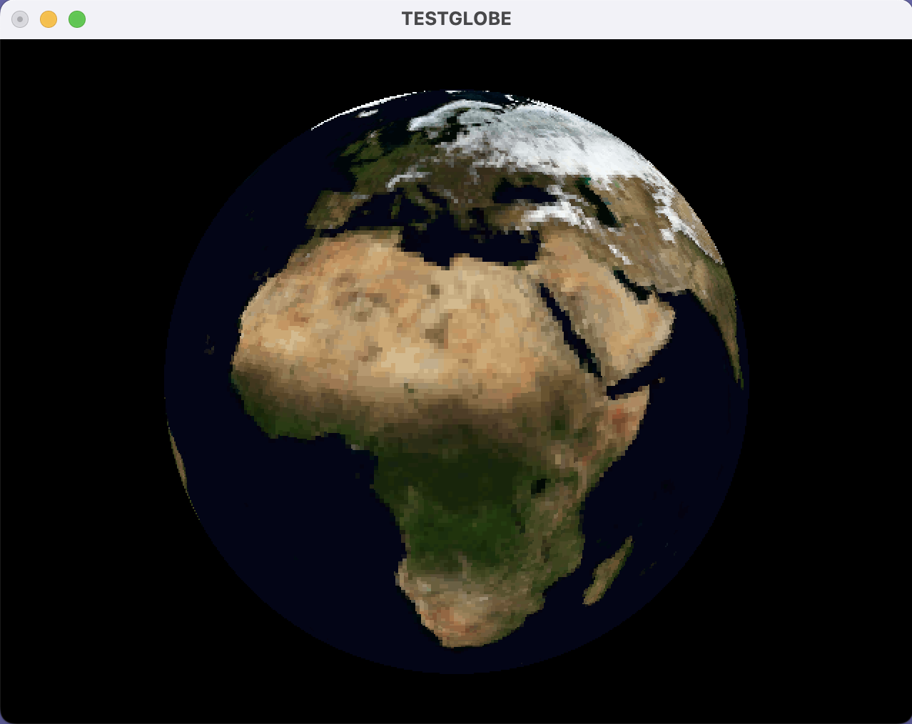

# testglobe

[Website](https://testglobe.dev) | [Repository](https://github.com/trguhq/testglobe/) | [WebGL](https://testglobe.dev/web/)

testglobe displays a 3D globe through different graphics APIs and hardware, with an
emphasis on systems from the late 1980s and early 1990s. It compares detail from
flat-shaded polygons with detail from texture mapping: flat shading assigns each
triangle or quad an Earth-map color, while texturing samples the map across it.
Texture mapping starts disabled. Higher resolutions use more memory and rendering time.

OpenGL is the original backend. The additional backends and subsequent changes include
AI-generated code. The experimental native backends have host regression coverage;
native validation remains pending. See [Testing and validation](#testing-and-validation) for
the distinction between host checks and native rendering.

Browser version: [live WebGL demo](https://testglobe.dev/web/).



*OpenGL driver running on macOS*

[Video: testglobe on a Sun Ultra 60 with Elite3D-m6 graphics](https://www.youtube.com/watch?v=CffPcvwioUA)

## Contents

- [Current drivers](#current-drivers)
- [Controls and status](#controls-and-status)
- [Binary releases](#binary-releases)
- [Build instructions](#build-instructions)
- [Testing and validation](#testing-and-validation)
- [Development notes](#development-notes)
- [Planned work](#planned-work)
- [Version history](#version-history)
- [License](#license)

## Current drivers

Earth maps store 8-bit palette indices. OpenGL and IRIS GL use those indices in either
RGB(A) or color-index windows; Sun XGL expands them to RGB. Matrox LibShell, TIGA,
Windows GDI, and QuickDraw draw through the Earth palette. Amiga maps those colors to the
current Workbench screen's pens or draws their RGB values on a truecolor RTG screen.
The browser frontend uses WebGL 2 with the same maps and palette.

| Driver | Platform | Default globe | Texture toggle |
| --- | --- | --- | --- |
| [WebGL](#webgl) | Modern browsers with WebGL 2 | Key 5: 512 × 256 | Yes |
| [OpenGL](#opengl) | Linux, Unix and modern macOS | Key 5: 512 × 256 | Yes |
| [Amiga OpenGL](#amiga-opengl) | AmigaOS 3.x, 68020/68881, PiStorm3D / MiniGL | Key 5: 512 × 256 | Yes |
| [IRIS GL](#iris-gl) | IRIX 4.0, 32-bit MIPS | Key 3: 128 × 64 | Yes |
| [Sun XGL](#sun-xgl) | Solaris 2.6, 32-bit SPARC | Key 3: 128 × 64 | Yes |
| [Matrox LibShell](#matrox-libshell) | MS-DOS, PG-641-compatible hardware | Key 1: 32 × 16 | No |
| [TIGA](#tiga) | MS-DOS, TIGA 2.x, 640 × 480 indexed color | Key 1: 32 × 16 | No |
| [Windows GDI](#windows-gdi) | Windows 3.1, 16-bit | Key 1: 32 × 16 | No |
| [QuickDraw](#quickdraw) | Classic Macintosh System 7, 68000 | Key 1: 32 × 16 | No |
| [Amiga](#amiga) | AmigaOS Workbench, 68000 and later, OCS/ECS/AGA or RTG | Key 1: 32 × 16 | No |

## Controls and status

Letter controls accept either case.

| Input | Action |
| --- | --- |
| `1`–`5` | Select globe resolution; Matrox LibShell and TIGA support only `1` and `2`. |
| Left mouse drag | Rotate the globe; the WebGL frontend also supports touch dragging. |
| `a` | Toggle automatic rotation. |
| `f` | Toggle FPS measurement and its on-screen statistic. |
| `o` | Toggle the on-screen display (OSD). |
| `t` | Toggle texture mapping in OpenGL, IRIS GL, Sun XGL, and WebGL. |
| `d` | Toggle display lists in OpenGL, or palette dithering in native Amiga; both start enabled. |
| `s` | Switch TIGA between host software 3D (default) and TI-processor transforms. |
| `Esc` | Exit native applications; in WebGL, pause rotation and release dragging. |

WebGL also provides on-screen controls and a **Reset view** button. Its retained GPU
buffers replace display lists; the `d` control applies to the native OpenGL and
Amiga backends.

Keys `1`–`5` select maps 32, 64, 128, 256, and 512 pixels wide (`EARTH_32` through
`EARTH_512`); map height is half the width. The OSD counts quad patches for Matrox,
TIGA, GDI, QuickDraw, and the native Amiga driver, and triangles for the other drivers.
Pole patches count as quads even when their vertices collapse to a triangle.

Console builds print the globe resolution, vertex count, and triangle or quad count
after each successful mesh construction. Failed attempts and selecting the current
resolution do not repeat these messages. GDI, QuickDraw, and Amiga use their native
OSD.

Matrox, TIGA, GDI, QuickDraw, and Amiga also report polygons retained after software
culling. The other drivers report totals because native culling supplies no visibility
count.
FPS starts enabled; turning it off leaves rotation timing active. FPS measures the
interval between completed presentations, including event-loop waits. It is an
interactive frame rate, not a synchronized GPU throughput benchmark; native swap
and flush calls provide different completion guarantees. Scene and rendering-mode
changes restart the sample.
Unix uses a monotonic clock where the platform exposes a compatible interface.
Older Unix and Amiga clocks accumulate elapsed time and rebase after backward system
clock changes, so adjusting the desktop clock does not stall rotation or FPS.

| Status | Meaning |
| --- | --- |
| `texture on` | The frame uses the graphics API's texturing path; this does not guarantee hardware acceleration. |
| `texture soft` | OpenGL or IRIS GL uses the application's software texture rasterizer. |
| `texture off` | Texture mapping is disabled. |
| `texture loading` | WebGL is fetching or uploading a texture; flat colors remain visible. |
| `texture fail` | Texturing is enabled but a detected failure prevents its use; recoverable failures draw flat colors. |
| `dlist on` | OpenGL successfully uses a display list for the current frame. |
| `dlist off` | Display lists are disabled. |
| `dlist fail` | Lists are enabled but unavailable, failed, or bypassed. |
| `dither on` / `dither off` | Amiga palette dithering is enabled / disabled; off uses the nearest solid palette color. |
| `dither n/a` | Amiga is drawing directly in RGB on a truecolor RTG screen. |
| `soft3d on` / `soft3d off (TI)` | TIGA uses host transforms / the embedded TI transform module; both use TIGA polygon filling. |
| `GWorld on` / `GWorld off` | QuickDraw is drawing through an offscreen GWorld / directly to the window. |

Toggle `t` off and on to retry after a recoverable texture failure. OpenGL software
texturing bypasses display lists, so enabled lists report `dlist fail` on that path.
XGL's internal software pipeline still reports `texture on`; IRIS GL cannot detect
all silent native texture failures. Their driver sections describe these limits.
OpenGL places `dlist` after FPS and before texture status, with its `d` help last.
QuickDraw appends GWorld status after the other statistics. TIGA appends `soft3d`,
CPU/FPU detection, and buffering status to the top statistics, and places `S` last
in its help. Failed TI module extraction or loading leaves `soft3d on` with a
recovery notice.
When a smaller texture is active, its width follows the status, for example
`texture on (128)` or `texture soft (128)`. GDI reports direct drawing, individual
polygons, reduced colors, or manual rotation when those fallbacks are active.

On displays of 640 × 480 or smaller, GDI and QuickDraw default to a 320 × 240 client
area; larger displays use 640 × 480. Explicit size requests are preserved, with
QuickDraw clamping its window to the selected screen.
GDI, QuickDraw, and Amiga resize the projection to the drawable client area. Narrow
windows clip the globe rather than stretching it. Amiga also accounts for the
Workbench display mode's pixel proportions.

### Resource recovery

Native backends do not rebuild the mesh when its current resolution is selected.
When a new mesh cannot be allocated, optional rendering caches are released before
retrying. The application can restore the previous resolution or select a smaller
supported level; startup uses the same lower-resolution fallback. The OSD identifies
the active result and any recovery notice. A scene that still cannot be built leaves
a responsive empty window so another resolution can be selected. Bad data and invalid
requests remain distinct from insufficient memory.
Recovery notices include the failure category. OpenGL, IRIS GL, and XGL force a
failed-frame diagnostic visible even when OSD is disabled, and suspend automatic
redraw until input requests another attempt.

Insufficient texture memory or a queried native size limit can reduce the image from
512 through 256, 128, 64, and 32 pixels wide. Other native errors are not assumed to
be memory shortages. If no usable texture can be created, the request remains enabled
while flat colors are drawn and `texture fail` is reported. Geometry caches and large
submission packets are optional: direct drawing or smaller packets preserve the same globe.
Fallback resolution, texture size, buffering, and cache use affect performance, so
compare runs using the actual reported settings.

These fallbacks preserve usable native rendering resources. Selecting another valid
resource can recover from bad map data, but does not repair the damaged resource.
A lost device or an opaque native-library error can still require shutdown.

## Binary releases

The [v0.1 release](https://github.com/trguhq/testglobe/releases/tag/v0.1) provides
OpenGL binaries for these platforms:

| Operating system | Architecture |
| --- | --- |
| IRIX | MIPS IV |
| Linux | ARM64 |
| macOS | x86-64 / ARM64 |
| Solaris | SPARCv8 |

## Build instructions

The [WebGL frontend](#webgl) runs without a native build. The portable Makefiles use
plain macro assignments and explicit rules shared by traditional Unix/System V make,
IRIX/Solaris make, and Microsoft NMAKE. GNU make is not required. Run the following
commands from the repository root or `src`, with the appropriate platform's compiler
and libraries installed:

| Target | Command | Output |
| --- | --- | --- |
| [OpenGL](#opengl) (default) | `make` or `make opengl` | `testglobe-opengl` |
| [Solaris OpenGL](#solaris-solaris-opengl) | `make solaris-opengl` | `testglobe-opengl` |
| [Apple OpenGL](#modern-macos-apple-opengl) | `make apple-opengl` | `testglobe-opengl` |
| [Amiga OpenGL](#amiga-opengl) (VBCC cross-compiler) | `make amiga-opengl` | `testglobe-amiga-opengl` |
| [IRIS GL](#iris-gl) | `make irisgl` | `testglobe-irisgl` |
| [Sun XGL](#sun-xgl) | `make xgl` | `testglobe-xgl` |
| [Matrox LibShell](#matrox-libshell) | `nmake matrox` | `testglob.exe` |
| [TIGA](#tiga) | `nmake tiga` | `testglob.exe` |
| [Windows GDI](#windows-gdi) | `nmake gdi` | `testglob.exe` |
| [QuickDraw](#quickdraw) (MPW bridge) | `make quickdraw` | `TestglobeQD` |
| [Amiga](#amiga) (VBCC cross-compiler) | `make amiga` | `testglobe-amiga` |

Native MPW users build QuickDraw with `Makefile.mpw` as described in its section. The
portable `quickdraw` target requires a configured bridge to the MPW tools.

### Common build settings

Objects and executables are written in the directory where make runs. For an
out-of-tree build, create a build directory, enter it, then run:

```sh
make -f /path/to/testglobe/src/Makefile SRC=/path/to/testglobe/src
```

Append the desired target, such as `apple-opengl`. The three desktop OpenGL targets
share `testglobe-opengl`; Amiga OpenGL produces `testglobe-amiga-opengl`. Matrox, TIGA, and
GDI share `testglob.exe`. Selecting a target relinks its
executable. Driver objects have separate names, so the Unix backends can coexist.

Traditional make does not track compiler-option changes. Clean the affected objects
before changing the compiler or build flags:

| Command | Removes |
| --- | --- |
| `make clean` | All build objects, generated build sources, temporary files, and application/helper binaries. |
| `make clean-<target>` | That backend's objects, executable, and backend-specific intermediates. Shared data sources and helpers generally remain. |
| `make clean-earth-data` | Generated `e_data.c`/`m_data.c`/`t_data.c`, converter binaries, and data-generation temporary files. |

Individual targets are `clean-opengl`, `clean-solaris-opengl`, `clean-apple-opengl`,
`clean-amiga-opengl`, `clean-irisgl`, `clean-xgl`, `clean-matrox`, `clean-tiga`, `clean-gdi`,
`clean-quickdraw`, and `clean-amiga`.
Under DOS use `nmake` with `RM=del`, for example `nmake clean RM=del`. Cleanup preserves
the supplied `src/e_saved.c`, canonical binary maps, and recovery `.bak` files.

Each build section lists its compiler and flag variables. The default Unix
`SYS_FLAGS=-DNO_SINF -DNO_GENMIPMAP` selects C89 `sin`/`cos` and GLU mipmaps for older
libraries. Apple OpenGL uses separate `APPLE_SYS_FLAGS` and the modern system math
library. See [OpenGL platform notes](#opengl-platform-notes) for optional mipmap support.

`DEBUG` defaults to `0`. After cleaning, use `make opengl CPPFLAGS=-DDEBUG=1` to enable
pixel-storage and right-button diagnostics. A System 7 single-button mouse has no
separate right-button state. Software texture buffers are released when texturing is
disabled; `CPPFLAGS=-DTEXTURE_CACHE_RASTER=1` retains them instead. Use the corresponding
CPPFLAGS variable for other targets. [Development notes](#shared-rendering-pipelines)
describe the cache and memory policy.

### Earth map data

Each native application embeds its selected Earth maps and needs no external Earth
data files at runtime. TIGA also embeds its TI transform module in the executable;
its installed graphics runtime remains a system requirement. WebGL fetches the same
binary inputs from the static site's `data/` directory. Preserve binary bytes when
transferring the project; preserve QuickDraw's application resource fork when copying
its executable.

| File | Role |
| --- | --- |
| `data/*.bin` | Canonical 8-bit Earth palette indices; edit these to change map data. |
| `src/e_bin.c` | Build-time converter for Unix and DOS. |
| `e_data.c` / `m_data.c` / `t_data.c` | Disposable generated C source for Unix / Matrox DOS / TIGA DOS builds. |
| `src/e_saved.c` | Supplied generated copy for manual builds; normal builds generate their own source. |
| `src/e_cmap.h` | Earth color palette. |
| `web/e_cmap.js` | Browser palette generated from `src/e_cmap.h` by `web/gen_cmap.py`. |
| `src/earthres.h` | Shared chunk size and native resource IDs. |
| `src/gdi.rc` / `src/qd.r` | Embed binary chunks as Windows `RCDATA` / Macintosh `EART` resources. |
| `src/ami_pack.py` / `src/ami_data.c` | Pack Amiga maps into the executable and read selected chunks on demand. |

| Map width | Binary inputs | Total bytes |
| --- | --- | --- |
| 32 | `e32.bin` | 512 |
| 64 | `e64.bin` | 2,048 |
| 128 | `e128.bin` | 8,192 |
| 256 | `e256_0.bin`, `e256_1.bin` | 32,768 |
| 512 | `e512_0.bin` through `e512_7.bin` | 131,072 |

OpenGL, IRIS GL, Sun XGL, Matrox, and TIGA compile generated arrays of at most 16
KiB. Driver `EARTH_*` defines select the maps included in each executable; Matrox and
TIGA include only the 32- and 64-wide maps. GDI and QuickDraw embed all maps as
native resources; Amiga stores them in an executable `HUNK_DEBUG` record that the OS
loader skips. The five maps total 170.5 KiB; the two maps in each Matrox/TIGA build
total 2.5 KiB. Generated and saved source files are build copies, not additional
runtime map allocations. Compiled-data paths borrow bounded read-only map spans. GDI,
QuickDraw, and Amiga load only selected map chunks into the final owned index buffer.
They retain 512 bytes of map indices at their EARTH_32 default, plus separate
palette, geometry, and display storage.

Make regenerates build source when missing or when an input changes. `EARTH_DATA`
(Unix) and `MTX_DATA` (DOS) select the input directory, defaulting to `data` beside
`SRC`. `EARTH_CC` and `EARTH_CFLAGS` select the Unix converter compiler and options;
DOS uses `MTX_CC` for Matrox and `TGA_CC` for TIGA. Both DOS targets use the
`MTX_DATA` input-directory setting.

| Task | Command |
| --- | --- |
| Refresh the supplied copy after changing binary inputs | `make earth-data` or `nmake earth-data-dos` |
| Remove build copies and converter tools | `make clean-earth-data` or `nmake clean-earth-data RM=del` |

The next application build regenerates removed source. For manual builds, compile
`src/e_saved.c` instead of the build copy; do not link both. The supplied copy was
formerly named `src/e_data.c`, so older manual compile commands need that filename change.

The converter rejects input/output aliases, nonregular destinations, occupied
`.tmp`/`.bak` paths, and Unix symbolic-link outputs. After an interrupted replacement,
keep any `.bak` until the output is verified or restored. Changing the chunk size also
requires resplitting the binaries and updating generator/resource tables; a compile-time
guard rejects stale generated readers.

### WebGL

#### Requirements

A modern browser with WebGL 2 enabled is required. Unsupported browsers show an
explanation; there is no WebGL 1 renderer. The frontend uses plain JavaScript ES
modules, with no framework, npm dependencies, or server-side application.

#### Run and host

Serve the repository root with any static HTTP server. For example:

```sh
python3 -m http.server 8000
```

Open `http://localhost:8000/web/`. Opening `web/index.html` directly through a
`file:` URL does not provide the HTTP fetching needed for modules and map data.
Publish `web/` and `data/` as sibling directories to retain the relative data URLs.
The browser page is independent of the existing README-based site landing page.

For GitHub Pages, include those directories in the branch/folder or Actions artifact
selected in **Settings → Pages**. Keep the existing README publishing setup and
`CNAME`; the demo is an additional page at `https://testglobe.dev/web/`. If Pages
publishes `main`, changes on `develop` must reach `main` before the demo becomes live.
The checked-in browser files need no build step during deployment.

The palette module is checked in. Regenerate it only when `src/e_cmap.h` changes:

```sh
python3 web/gen_cmap.py
python3 web/gen_cmap.py --check
```

The binary maps remain canonical; the browser does not maintain another map-data
source. `web/package.json` supplies ES-module scope for Node-based checks and does
not add a runtime package-install step. Native Makefile targets and historical
toolchains do not require any browser tooling.

#### Rendering and controls

The default is key 5, with texturing off. Keys `1`–`5` select the same 32- through
512-wide maps as the native drivers. Keyboard controls, on-screen buttons, and
mouse/touch dragging operate the globe; **Reset view** restores the initial view and
pauses automatic rotation.
`Esc` pauses rotation and releases dragging without closing the browser.

WebGL retains vertex/index buffers and draws latitude strips with native transforms,
depth testing, and back-face culling. Flat shading quantizes UV coordinates to Earth
patches, then looks up each patch's palette index and RGB color. Texture mapping
normally uses a separate 512 × 256 RGB image and GPU-generated mipmaps, independently
of the selected globe resolution. There is no display-list toggle.

Missing map data or allocation shortages at startup can select smaller resolutions.
A failed resolution change preserves an existing globe; **Retry** requests the chosen
level again. Texture data or allocation failures try smaller images before falling
back to flat colors with `texture fail`; the OSD reports reduced texture sizes. Toggle
texture off and on to retry. Unrelated graphics errors are not treated as evidence of
insufficient memory.
Context loss suspends drawing while retaining the requested settings, then
rebuilds resources when the browser restores the context. Errors and recovery
messages remain visible outside the optional overlay.

The canvas follows its available size, with a capped rendering resolution for large
or high-density displays. FPS follows `requestAnimationFrame` and browser refresh
scheduling; it is not directly comparable to native GPU benchmark results.

#### Validation

See the [WebGL checks](tests/README.md#webgl) for palette/data checks and browser
tests. Browser rendering depends on its graphics implementation and available
device resources; desktop and mobile environments can differ.

### OpenGL

#### Requirements

The desktop targets require OpenGL 1.1, GLU, and GLUT, with a legacy or compatibility
context. [Amiga OpenGL](#amiga-opengl) uses MiniGL and native Amiga windowing instead.
On Debian or Ubuntu, install the development libraries with:

```sh
sudo apt-get install freeglut3-dev
```

Archived Solaris GLUT packages are available for
[32-bit SPARC](https://web.archive.org/web/20010726175006/http://reality.sgi.com/opengl/glut3/glut-3.7b.sparc_solaris.tar.gz)
and
[64-bit SPARC](https://web.archive.org/web/20010726192034/http://reality.sgi.com/opengl/glut3/glut-3.7b.sparc_solaris_64.tar.gz).
Modern macOS uses Apple's frameworks.

#### Build

##### Unix build (`opengl`)

```sh
make opengl
./testglobe-opengl
```

The default compiler is `cc` with `-O`. Override `CC`, `CPPFLAGS`, `CFLAGS`, `SYS_FLAGS`,
and `LDFLAGS` for the installed compiler and libraries.

##### Solaris (`solaris-opengl`)

Use the Solaris C compiler, OpenGL/GLU, GLUT, and OpenWindows libraries:

```sh
make solaris-opengl
./testglobe-opengl
```

`SOLARIS_CC` defaults to `CC`; `SOLARIS_CFLAGS` defaults to `CFLAGS`.
`OPENWINHOME=/usr/openwin` selects headers, libraries, and the runtime search path.
Override `SOLARIS_CPPFLAGS`, `SOLARIS_SYS_FLAGS`, and `SOLARIS_LDFLAGS` as needed.
The compiler's default architecture and ABI are retained.

The equivalent library settings for the generic target are:

```sh
make opengl CC=cc CPPFLAGS=-I/usr/openwin/include \
  LDFLAGS="-L/usr/openwin/lib -R/usr/openwin/lib -lglut -lGL -lGLU -lX11 -lXmu -lm"
```

##### Modern macOS (`apple-opengl`)

Use the selected Xcode Command Line Tools and their macOS SDK:

```sh
make apple-opengl
./testglobe-opengl
```

This target links `-framework GLUT -framework OpenGL -framework Cocoa`; GLU comes
from `OpenGL.framework` and math functions from the system runtime. No Homebrew or
XQuartz installation is needed. The selected toolchain supplies Intel or Apple silicon
architecture and SDK defaults.

`APPLE_CC` defaults to `CC` (`cc`, normally Apple's Clang); `APPLE_CFLAGS` defaults to
`CFLAGS`. Override `APPLE_CPPFLAGS`, `APPLE_SYS_FLAGS`, and `APPLE_LDFLAGS` as needed.
The default `APPLE_SYS_FLAGS=-DNO_GENMIPMAP -DGLUT_SILENCE_DEPRECATION` selects GLU
mipmaps and suppresses GLUT deprecation warnings. Apple builds use `<GLUT/glut.h>`.

<a id="amiga-opengl"></a>

##### Amiga PiStorm3D (`amiga-opengl`)

This target reuses `drv_ogl.c` with the Amiga adapter `ogl_ami.c`. It requires
AmigaOS 3.x, a PiStorm using Raspberry Pi 4 / CM4 / 4B hardware, RTG graphics with
`cybergraphics.library` V40 or later (including Picasso96 compatibility), and
PiStorm3D's shared `minigl.library` V29 with dispatch ABI 5. The build selects a
68020 instruction set with 68881 floating point, supplied by the PiStorm environment.
The separate [`amiga` target](#amiga) continues to provide chipset/RTG software rendering.

Use the [MiniGL SDK repository](https://github.com/SteffenHaeuser/MiniGL_Library_68k/)
`MiniGL_Classic` branch, whose `libraryroot/include` directory contains the current
shared API headers. The SDK was checked at commit
[`d950a3a1`](https://github.com/SteffenHaeuser/MiniGL_Library_68k/commit/d950a3a1ed640785a735f7d594298eaf3233b794).
The root `include` directory on older branches contains ABI 3 headers with different
GL token values; it is not interchangeable. The application checks the library's
version, dispatch ABI, and table size before using it. Install the matching
**PiStorm3D** runtime implementation in `LIBS:minigl.library`; the SDK branch name
does not select the graphics hardware at runtime.

Cross-compilation needs VBCC's `aos68k` target, vasm/vlink, Amiga NDK headers, a host
C compiler for the Earth-data converter, and Python 3.8 or later for the icon:

```sh
git clone --branch MiniGL_Classic --single-branch \
  https://github.com/SteffenHaeuser/MiniGL_Library_68k.git minigl-sdk
export VBCC=/path/to/vbcc
export PATH="$VBCC/bin:$PATH"
make amiga-opengl MINIGL_ROOT=/path/to/minigl-sdk
```

The output is `testglobe-amiga-opengl` and its Workbench icon,
`testglobe-amiga-opengl.info`. Copy both for icon launch. The icon requests a
128 KiB stack. CLI launches must set the stack explicitly:

```text
Stack 131072
testglobe-amiga-opengl
```

`AOGL_CC`, `AOGL_CONFIG`, `AOGL_CFLAGS`, `AOGL_CPPFLAGS`, `AOGL_INCLUDES`,
`AOGL_LDFLAGS`, `AOGL_LIBS`, and `AOGL_PYTHON` configure this target. Defaults are
`vc +aos68k`, `-c99 -O1 -cpu=68020 -fpu=68881`, and `-lm881 -lamiga`.
C99 mode accommodates the external SDK headers; the shared application sources
retain their C89 paths. Add NDK include paths through `AOGL_CPPFLAGS` if the VBCC
configuration does not supply them. `EARTH_CC` selects the host data-converter
compiler. Earth maps are linked from generated `e_data.c`, as in desktop OpenGL;
no runtime map files or Amiga Hunk-resource packing are needed.

The adapter opens the shared library directly through its dispatch interface, so
no GCC import archive, GLUT, X11, or separate GLU library is linked. MiniGL performs
transforms, clipping, depth/culling, texture mapping, mipmap construction, and display
lists. Intuition supplies the resizable Workbench window and mouse/keyboard input;
MiniGL renders through `mglCreateContextFromBitMap` into an application-owned BGRA32
RTG bitmap. Presentation waits for the GPU and copies within the allocated bitmap
bounds before native Amiga text draws the OSD. Resizing recreates the bitmap and
MiniGL context, then restores rendering state and the requested texture.

All five resolutions remain available, with key 5 selected initially, textures off,
and display lists on. The target uses RGB rendering. Flat strips are split into
bounded runs of one color because PiStorm3D's flat-shading color applies to an entire
submission; pole triangles are submitted separately. Textured strips are bounded to
the native vertex-buffer limit. These subdivisions preserve facet colors, winding,
and texture seams without changing the shared `TRISTRIP` scene traversal.

PiStorm3D V29 display-list replay does not preserve these flat-color runs. The driver
therefore bypasses lists for flat-colored frames and reports `dlist fail` while the
list toggle remains enabled. Textured frames can use display lists because their
`GL_REPLACE` material does not depend on the replayed vertex colors.

#### Rendering and color

Desktop OpenGL sends each interior latitude band as a triangle strip; both polar
caps share one batch of nondegenerate triangles. Flat colors, winding, and texture seams match the independent
triangle path. The default globe is key 5. Display lists cache native geometry and
start enabled; disabling them deletes the cache, while enabling them rebuilds it on
the next native frame. See [Controls and status](#controls-and-status).

On desktop OpenGL, the driver probes RGBA, RGB, and color-index formats with
single/double-buffer and depth-buffer alternatives. It prefers RGB(A) over color index, then greater total
RGB-plus-alpha precision before buffering. Requests include 8/8/8/8, 8/8/8, 5/6/5,
5/5/5, unconstrained RGB(A), and color index with at least eight bits. GLUT probes do
not enumerate every native visual; older implementations may expose fewer choices.
Classic GLUT RGB fallbacks do not require an alpha channel.

When GLUT lacks `GLUT_DISPLAY_MODE_POSSIBLE`, the driver makes the original single
RGB, double-buffered window request and reads the resulting window attributes.
It cannot safely probe alternative formats on those implementations: an unsupported
request may terminate GLUT instead of returning a failure.

Flat shading retains each Earth palette byte, converting it to RGB for RGB(A) windows
or submitting the index directly. Color-index windows use the shared software texture
rasterizer because classic OpenGL texturing requires RGB(A) mode. That path bypasses
display lists.

#### Platform notes

<a id="opengl-platform-notes"></a>

Display-list allocation, compilation, validation, and execution are checked with
OpenGL 1.1 calls, including `glIsList` and `glGetError`. A failed cache is discarded and
geometry is drawn immediately. Texture-memory shortages and native size limits try
smaller images; other texture failures release failed resources and draw flat colors.
Failed lists are not rebuilt every frame or on resolution changes; toggling `d` or
`t` explicitly permits a retry.
Diagnostics use `glGetError`, without modern debug extensions.

The desktop targets default to GLU mipmaps; Amiga OpenGL uses MiniGL's GLU-compatible
mipmap builder. Omitting `NO_GENMIPMAP` permits an optional desktop
path when FreeGLUT 2.0 or later headers are available: the running context must report
OpenGL 3.0 or later, `glGenerateMipmap` must resolve at runtime, and the image must fit
the texture limit. Otherwise the driver uses `gluBuild2DMipmaps`. No post-1.1 OpenGL
symbol is required at link time, and `GL_GLEXT_PROTOTYPES` is unnecessary.

#### Validation

See the [OpenGL host checks](tests/README.md#opengl). Physical color-index behavior
requires an implementation offering that visual. Native Apple SDK compilation and
rendering require macOS; Solaris builds require its installed graphics libraries.
See the [Amiga OpenGL host checks](tests/README.md#amiga-opengl) for its MiniGL
submission and Amiga event tests. VBCC/SDK cross-builds check native compilation;
PiStorm3D hardware is still needed to validate VideoCore rendering, library ABI
behavior, and RTG presentation.

### IRIS GL

#### Requirements

Use native 32-bit MIPS IRIX 4.0 with the IRIS GL development headers and runtime.
Windowing, input, and rendering use IRIS GL directly.

#### Build

```sh
make irisgl
./testglobe-irisgl
```

`IGL_CC` defaults to `CC`; override `IGL_CPPFLAGS`, `IGL_CFLAGS`, `IGL_SYS_FLAGS`, and
`IGL_LDFLAGS` for the installed tools. Defaults select `FLAT`, `DRV_IGL`, C89 math,
and `-lc_s -lgl_s -lm`, following the IRIS GL Programming Guide's shared-library
example. No later MIPS ISA or ABI is imposed.

#### Rendering and color

The default globe is key 3. IRIS GL performs model/view transforms, 45-degree
perspective, clipping, triangle-mesh drawing, back-face rejection, and bitmap-font
OSD. Geometry is cached in a GL object and rebuilt for resolution or texture changes.
If the object cannot be allocated or validated, the driver draws the same geometry
directly and retains the user's requested rendering settings.
Failed creation or immediate validation disables further cache construction until
texture enabling permits a retry. If a previously valid object
disappears, direct drawing preserves the frame and the cache can be rebuilt.
Interior bands use `bgntmesh`/`endtmesh`; polar caps use three-vertex meshes.

Runtime queries compare single- and double-buffered RGB(A) formats, preferring total
channel precision, then alpha and RGB precision, then double buffering. If RGB is
unavailable, the driver selects the largest color-index mode with at least eight bits.
Flat colors retain the Earth index and convert to RGB when needed. Color-index mode
installs the Earth palette and restores it at exit. A z-buffer is used when available;
the convex globe can also be drawn with back-face rejection alone.

Native texturing uses `texdef2d`, `t2f`, mipmaps, and bilinear filtering. When unavailable,
the shared software rasterizer draws the textured globe using matrices supplied by
IRIS GL, then presents the image through IRIS GL. Flat rendering remains native.

#### Platform notes

The event queue supplies keyboard, drag, resize, focus, and close events. Interrupted
tied mouse samples and queue overflow resample mouse state without blocking on missing
samples or discarding later keyboard/close events.

Texture definition, binding, and pixel-transfer calls return no success value. The
driver detects allocation failures, missing data, and lost texture capability, but
cannot confirm silent failures inside the native library. Consequently, `texture on`
means native submission for that frame. Recoverable failures discard failed state and
cached geometry before drawing flat colors.

#### Validation

See the [IRIS GL host checks](tests/README.md#iris-gl). Native validation must cover
the IRIX 32-bit ABI, graphics hardware, fonts, window manager, and pixel transfer.

### Sun XGL

#### Requirements

Use 32-bit SPARC Solaris 2.6 with Sun XGL 3.x, X11/OpenWindows, and a 24-bit TrueColor
visual. The driver uses Xlib directly.

#### Build

```sh
make xgl
./testglobe-xgl
# For nonstandard SDK locations:
make xgl XGLHOME=/path/to/xgl OPENWINHOME=/path/to/openwin
```

Defaults are `/opt/SUNWits/Graphics-sw/xgl` and `/usr/openwin`. Override
`XGL_CPPFLAGS`, `XGL_CFLAGS`, `XGL_SYS_FLAGS`, and `XGL_LDFLAGS` as needed; the native
compiler's 32-bit default is used. When relocating the runtime, also set the shell's
`XGLHOME` for the installed pipeline and font files.

#### Rendering and color

The default globe is key 3. Each interior latitude band uses `xgl_triangle_strip`;
polar caps use nondegenerate three-vertex strips. Both triangles of each Earth patch
share its flat RGB color. XGL performs transforms, clipping, back-face handling,
depth testing, and texturing. Texture mapping uses REPLACE mode and preserves UV seams.
X11 handles keyboard, mouse, expose, resize, and window-close events.
The OSD wraps using native stroke-font measurements; windows too small for a line
omit it, and help never overlaps the statistics.

#### Platform notes

XGL supplies its own software pipeline when hardware cannot accelerate texturing.
Because the API exposes no reliable per-frame backend query, successful texturing
reports `texture on` for either internal path. Recoverable texture failures release
partial resources and draw flat colors. Nonrecoverable errors and unrelated setup,
native rendering, or OSD errors remain fatal. Native texture rasters are filled from
indexed map rows without an intermediate full RGB image. Packet allocation failures
use smaller strips, retaining overlap, winding, colors, and UVs.

#### Validation

See the [Sun XGL host checks](tests/README.md#sun-xgl). Native SDK compilation, ABI
compatibility, and physical rendering require the Sun SDK/runtime on Solaris.

### Matrox LibShell

#### Requirements

Use MS-DOS, Microsoft C 7.0 with its huge-model runtime and NMAKE, and the matching
Matrox LibShell C binding. The driver assumes a 640 × 480, 256-color PG-641-compatible
display. Initialize the board and firmware according to the SDK. A Microsoft-compatible
DOS mouse driver enables dragging; keyboard controls work without one.

#### Build

Place the SDK at the repository root:

```text
XGX1/HEADERS/DEF.H
XGX1/HEADERS/LIBFN.H
XGX1/HEADERS/IOLIB.H
libsv5/lscl.lib
```

With the compiler and linker on `PATH`, run:

```text
nmake matrox
```

The output is `testglob.exe`. For an external SDK use `XGX_ROOT=C:\MATROX`; the default
is `.` in the root Makefile and `..` in `src/Makefile`. Override `MTX_CC`, `MTX_CFLAGS`,
`MTX_CPPFLAGS`, `MTX_LIB`, and `MTX_LDFLAGS` as needed, keeping `-AH`. DOS rules use
backslash paths, 8.3 generated names, and response files for command-line limits.

#### Rendering and color

The default globe is key 1; only keys 1 and 2 are available, with no texture controls.
LibShell performs transforms, orthographic projection, viewport clipping, and filled
world-coordinate polygons through `v3arwplygn` (`V3ARWPLYGN`). Patches are quads, with
coincident pole vertices collapsed to triangles. All 256 LUT entries come from
`earth_cmap`, and polygons use the original palette indices.

#### Platform notes

The host rejects back-facing polygons because the base PG-641 interface documents
neither a depth buffer nor a back-face switch. DOS uses normalized huge pointers,
`_halloc`/`_hfree`, long mesh counts, and DOS timing.

LibShell errors are serviced while waiting for inquiry replies between bounded command
packets. Diagnostics identify the operation and error bits. Reply polling has a
ten-second deadline; short malformed replies are drained, while oversized replies or
timeouts abandon communication. Cleanup restores the palette and error policy when
communication remains usable and sends no further board commands after abandonment.

#### Validation

See the [Matrox SDK host checks](tests/README.md#matrox-libshell). Native validation
requires Microsoft C 7, `LSCL.LIB`, and the board. Polling assumes a nonblocking
`iogeterror()` and a positive `rdfifocnt()` permitting a complete `iogetw()` without
waiting. The supplied headers do not establish FIFO count units or atomic word
availability; verify these assumptions against the installed binding and board.

### TIGA

#### Requirements

Use real-mode MS-DOS, Microsoft C 7.0 with its huge-model runtime and NMAKE, and a
TIGA 2.x installation for the board. This is a full-screen DOS application. The
vendor's `TIGACD.EXE` communication driver, graphics manager, and standard
`extprims.rlm` library must be installed and configured. The driver requires a 640 ×
480 mode with eight valid pixel bits and a programmable 256-color palette. It queries
mode numbers instead of assuming a particular board. A Microsoft-compatible DOS mouse
driver enables dragging; keyboard input works without one.

#### Build

Install the SDK's `include` and `libs` directories under `TIGA` at the repository
root, or pass its DOS installation path. Put Microsoft C and the TI TMS340
code-generation tools on `PATH`, then run:

```text
nmake tiga TGA_ROOT=C:\TIGA
```

Distribute only `testglob.exe`. It contains both Earth maps and the TI transform
module. The host links `ai.lib`; the TI tools build `tga_gsp.rlm` from
`src/tga_gsp.c` and `src/tga_ext.asm`, then `src/tga_pack.c` appends it to the host
executable. `tga_gsp.rlm`, `tga_host.exe`, and the packer are build intermediates.
The appended bytes remain outside the DOS load image, so software mode retains no
extra module copy in DOS memory.

The module uses TMS34010 instructions, also supported by TMS34020, and requires no
floating-point coprocessor or TI math runtime. `src/tga_cmd.h` defines its bounded
command and embedded-file formats. To build a software-only executable without the
TI tools or embedded module:

```text
nmake tiga TGA_ROOT=C:\TIGA TGA_MODULE=
```

`nmake tiga-module` builds the module alone. Set `TGA_MODULE` to a prebuilt RLM
path to embed it without rebuilding the TI code. Override `TGA_CC`, `TGA_CFLAGS`,
`TGA_386FLAGS`, `TGA_CPPFLAGS`, `TGA_LIB`, and `TGA_LDFLAGS` for the host
installation. `TGA_GSP_CC`, `TGA_GSP_LINK`, `TGA_GSP_CFLAGS`, `TGA_GSP_CPPFLAGS`, and
`TGA_GSP_LDFLAGS` select the TI tools. Preserve `-AH` and the separate baseline/386
object settings. The default `TGA_ROOT` is `TIGA` in the root Makefile and `..\TIGA`
in `src/Makefile`. The executable embeds only the 32- and 64-wide Earth maps. A
software-only build still renders through TIGA; pressing `S` leaves software 3D on.

#### Module loading

When `S` first selects TI transforms, the driver reads the embedded payload from its
own executable and streams it through a bounded buffer into a uniquely created
temporary file. It tries `TEMP`, `TMP`, then the current directory. TIGA
`install_rlm()` requires a filename; the file is normally deleted immediately after
loading. If deletion fails, its path is retained for another attempt on `S` or exit.
The resident TI module is reused until released or the application exits. No separate
module or Earth-data files need to accompany `testglob.exe`.
Installation discards unused module export symbols to conserve TI memory. Optional
release uses TIGA's documented `flush_module()` call; failed release retains the
module identifier for reuse or another attempt while drawing through host transforms.

If the executable cannot be reopened, the payload is missing or corrupt, temporary
storage is unavailable, or TIGA rejects the module, rendering continues with
`soft3d on` and an OSD notice. Press `S` to retry. The application does not search for
a neighboring `tga_gsp.rlm`. The vendor graphics driver, graphics manager, and
`extprims.rlm` remain part of the installed TIGA environment.

#### Rendering and controls

Key 1 is the default; only keys 1 and 2 are available, with no texture controls. Both
transform modes use TIGA's `fill_convex()` for indexed polygons, with the general
polygon fill retained for nonconvex results after rounding. Native bitmap text draws
the OSD. All 256 palette entries come from `earth_cmap`; the installed TIGA runtime
adapts them to the board's DAC precision. Quads retain the shared globe traversal,
with collapsed pole patches drawn as triangles.

`S` or `s` toggles between:

- **`soft3d on` (default):** host rotation, projection, clipping, and culling, using
  the shared software pipeline. An available x87 selects floating-point transforms;
  otherwise the 286-compatible or separately compiled 386 integer path is used.
- **`soft3d off (TI)`:** the downloadable module performs fixed-point rotation,
  view translation, and ordinary perspective projection on the TMS340 processor.
  Matrix preparation, clipping, culling, and polygon submission remain on the host.
  Depth-crossing polygons retain the shared host clipping/projection path. Floating
  host transforms and fixed-point TI transforms can differ slightly at rounded edges.

Insufficient command capacity or rejected transform packets restore software 3D
with an OSD notice. Press `S` to retry. Host/GSP packets contain bounded 32-bit values
rather than host pointers or compiler-dependent structures. A mode with
two display pages is preferred; completed frames use synchronized page flips, and the
previous page is not reused until the flip completes. A single-page mode remains
usable but can flicker and reports its buffering status.

#### CPU and platform notes

CPU detection distinguishes 286, 386, and 486-or-later without requiring CPUID. The
program remains a 16-bit real-mode executable. Baseline objects use `/G0`; only the
guarded 386 transform object uses `/G3`, and 486-or-later CPUs use that same path.
`/FPi` retains the Microsoft emulation runtime for startup, mesh generation, and
other floating-point work when no coprocessor is available.

The x87 probe checks the BIOS equipment flag and uses bounded, no-wait coprocessor
status reads. An unreported or unavailable coprocessor selects integer transforms.
Set `NO87=1` to force that choice. CPU/FPU and buffering details accompany `soft3d`
in the top OSD. No board-specific addresses or registers are accessed by the host.

#### Validation

See the [TIGA host checks](tests/README.md#tiga), including executable packing,
corrupt-payload rejection, temporary-file failures, and cleanup. The downloadable
module was compiled and linked with TI TMS340 tools 5.01 under DOSBox, independently
of host contract tests. Microsoft C 7 host compilation, segmented ABI and
communication callbacks, TIGA module loading, physical rendering, and page-flip behavior still
require native validation. The interface follows
[TI's TIGA Interface User's Guide](https://github.com/tms34010guy/tms34010-sdk/blob/main/Docs/SPVU015C%20TIGA%20Interface%20Users%20Guide%20%281990-09%29.pdf)
(September 1990).

### Windows GDI

#### Requirements

Use Windows 3.1 in a 256-color display mode, Microsoft C/C++ 7.0 with the Windows
emulation runtime (`LLIBCEW.LIB`), and the Windows 3.1 SDK headers, `LIBW.LIB`, 16-bit
linker, and resource compiler. This target produces a native 16-bit application.

#### Build

Configure `PATH`, `INCLUDE`, and `LIB`, then run:

```text
nmake gdi
```

Run `testglob.exe` inside Windows 3.1. Override `GDI_CC`, `GDI_LINK`, `GDI_RC`,
`GDI_CFLAGS`, `GDI_CPPFLAGS`, `GDI_LIBS`, `GDI_LDFLAGS`, `GDI_RCFLAGS`, and `GDI_DATA`
as needed. Preserve `-AH -G2 -Gw -Zp1 -FPi` when overriding `GDI_CFLAGS` to keep the
memory model, Windows ABI, and optional FPU settings.
`GDI_DATA` defaults to `data` at the root and `..\data` inside `src`.

The `.def` file exports the window procedure and specifies segment attributes, an
8 KiB local heap, and a 16 KiB stack. `RC -r -fo` compiles `src/gdi.rc` and all 13 map
chunks into `g_earth.res`; `RC -t g_earth.res testglob.exe` attaches it. Discardable
`RCDATA` chunks avoid large static arrays. The huge-model app permits one running
instance at a time.

#### Rendering and color

The default globe is key 1, with all five resolutions and no texture mapping. The
window uses the display's 8-bit depth. A 256-entry logical Earth palette is realized
on activation; Windows retains its reserved system colors. An 8-bit compatible bitmap
and memory DC normally provide the back buffer. If they cannot be allocated, the
driver paints directly into the window's paint DC.

Exact realized palette colors use solid brushes. For other colors, the driver uses
the same two-color matcher as Amiga, selecting from the colors Windows actually
realizes and drawing a palette-indexed pattern brush. Palette changes refresh the
matches and brush cache. If palette queries or pattern allocation fail, drawing
falls back to a solid palette brush.

Software transforms, perspective projection, clipping, and culling operate on whole
quads. Bounded packets reuse adjoining transformed rows and projected corners, then
retained polygons are grouped by palette index for `PolyPolygon` calls of at most
64 polygons. Pole vertices collapse to triangles. Visibility relies on the convex
globe rather than a depth buffer for intersecting geometry. Native Windows messages handle input, resizing,
palette changes, and window closure.
Failed `PolyPolygon` submission can fall back to individual `Polygon` calls. Brush
allocation can reclaim cached brushes or use a stock color. Failure to create the
animation timer leaves manual rotation and keyboard input available.

#### Platform notes

`GetWinFlags` selects floating-point transforms on supported 80387-or-later systems;
other systems use the shared integer pipeline. Mesh generation and FPS bookkeeping
still use floating point. Keep `-FPi` so the Windows runtime can emulate those
operations when necessary; `-FPi87` would require a coprocessor.

Windows global memory supplies allocations larger than 64 KiB. `SEG86` shares the
segmented pointer model with DOS, while `GDI` selects Windows allocation, startup,
errors, and timing. Fatal errors stop rendering, animation, capture, and input before
showing a modal dialog, preventing reentrant access to incomplete state.

#### Validation

See the [GDI host checks](tests/README.md#windows-gdi). Microsoft C 7 and Windows 3.1
must validate segmented code, loader format, emulator dispatch, and physical palette
mapping.

### QuickDraw

#### Requirements

The QuickDraw driver targets a System 7 application built with Apple's 68K MPW C
compiler and Macintosh interfaces. Use the System 7-compatible Universal Interfaces 2.2
headers and Rez templates, the matching MPW C libraries, and the `C`, `Link`, `Rez`, and
`Make` tools. Set MPW's `CIncludes`, `RIncludes`, `Libraries`, and `CLibraries` to the
installed interface/library folders. The SDK files and tools are external dependencies
and are not redistributed here.

#### Build

`Makefile.mpw` is a separate, native MPW Make file: MPW's rule syntax, variables, and
shell differ from Solaris make and Microsoft NMAKE. It is stored in MacRoman with
classic CR line endings; preserve those bytes. Transfer the ASCII C/header/Rez sources
as Macintosh text, converting their Unix line endings to CR in the build copy (for
example, `unix2mac src/*.c src/*.h src/*.r` before transfer). Do not convert
`Makefile.mpw` from UTF-8; it is already in its native encoding.

In MPW Shell, set the current directory to the repository root and run:

```text
Make -f Makefile.mpw quickdraw > QDBuild
Execute QDBuild
```

MPW Make emits commands rather than executing them; the second line runs the generated
commands. From `src`, use `Make -f ::Makefile.mpw -d QD_SRC=: quickdraw > QDBuild`, then
`Execute QDBuild`. Build output is `TestglobeQD`, a Finder-launchable `APPL` with
creator `Tglo`. Preserve its resource fork when transferring it to another Mac, using a
resource-aware copy or a MacBinary/BinHex archive.

The build needs the C/header files in `src`, `src/qd.r`, `Makefile.mpw`, and all 13
`data/*.bin` files. The binary files contain Earth palette indices in
chunks of at most 16 KiB; transfer them as binary without newline conversion. Rez embeds
them as `EART` resources with IDs from `src/earthres.h`, keeping large initialized
arrays out of the A5-relative globals. Keep `data` beside `src`: the Rez `read`
statements use explicit source-relative `::data:` paths, since native MPW Rez does not
use its `-i` header search paths for these binary reads.

The portable `make quickdraw` target can use the external
[MPW tool/shell bridge](https://github.com/ksherlock/mpw-shell) with a configured MPW
installation: `MPW_EXEC` defaults to its `mpw-make` executable. It invokes the same
native file and passes `QD_DEFINES` (`-d SEG68 -d DRV_QD -d DRV -d NO_SINF`) and the
source directory; `MPW_EXEC`, `QD_MAKEFILE`, `QD_SOURCE`, and `QD_DEFINES` are
overridable. Native MPW builds need no bridge or modern scripting language. Use
`Make -f Makefile.mpw clean > QDBuild` and `Execute QDBuild` for native cleanup. The
portable `clean-quickdraw` target and ordinary `make clean` remove the QuickDraw
objects and application using `RM`, without requiring MPW tools.

#### Rendering and color

The default globe is key 1, with all five resolutions and no texture mapping. Software
quad batches reuse transformed rows and projected vertices, then clip and cull whole
polygons. Pole vertices collapse to triangles. QuickDraw fills each retained polygon
with `PaintPoly`, `FillCPoly`, or `FillPoly`; batching shares geometry work rather
than adding a native multiple-polygon call. OSD text uses QuickDraw.

The driver chooses the highest currently configured depth among active displays,
without changing display modes. It supports monochrome and Color QuickDraw: 1-bit
output uses ordered luminance patterns, 4/8-bit output maps Earth RGB colors to the
device palette, and 16/32-bit output uses native RGB drawing.
Color QuickDraw receives the original RGB values through `MakeRGBPat`/`FillCPoly`.
Its native ditherer can combine four palette colors and reconverts patterns when
the device palette or depth changes. The Amiga two-color matcher is therefore
unnecessary here; monochrome also retains its finer 64-step luminance patterns.
One checked polygon handle is reused for all fills, avoiding per-polygon recording
allocations. Once per pass, a temporary allocation probes 8 KiB of contiguous
headroom for pattern drawing or 4 KiB for basic fills; it is immediately freed.
This bounded memory preflight can disable optional color dithering or pause
drawing when native scratch space is scarce; checked allocation failures release
optional resources before one retry. Repeated failure pauses drawing until input
requests another attempt. Native QuickDraw pattern and fill routines can still invoke
system errors or silently omit drawing on internal allocation failure. These opaque
Toolbox operations do not provide a general recoverable-allocation guarantee.

With 32-bit QuickDraw, an optional GWorld supplies an offscreen back buffer presented
through `CopyBits`. This uses ordinary GWorld pixel memory. QuickDraw selects available
display acceleration; allocation or pixel-lock failure falls back to the window. The
OSD reports the actual buffer path. Activation, resume, and completed window drags
recheck device depth and bounds, rebuilding display resources when they change.

#### Platform notes

The baseline 68000 sources are `main.c`, `drv.c`, `err.c`, `globe.c`, `drv_qd.c`, and
integer-only `soft3d.c`, built with `SEG68` and `DRV_QD`. MPW's SANE floating-point code
works without a coprocessor. Only `qd_fpu.c` and the shared `soft3fp.c` receive
`-mc68020 -mc68881`; their pointer-and-integer interface and separate `QDFPU` code
segment avoid mixing SANE and hardware floating-point calling conventions. The driver
checks both CPU and FPU before calling them. Do not enable direct FPU flags for
baseline objects.

Linking uses MPW's startup/runtime, interface, standard C, `Math.o`, and `CSANELib.o`
libraries. `QD_RUNTIME` defaults to `{Libraries}Runtime.o`; override it and
`QD_LIBRARIES` for MPW releases with different runtime filenames.

`src/qd.r` supplies an 8 MiB preferred and 512 KiB minimum application partition,
suspend/resume and 24/32-bit addressing attributes, and error-alert resources. Higher
resolutions and larger GWorlds need a larger partition. Windows and menus are created
by the driver. Heap allocation and `TickCount` timing use `SEG68`; classic Macintosh
A5-relative globals and segmented `CODE` resources have their own memory model.

Before a fatal alert, the driver releases pending polygons, unlocks pixels, and restores
the caller's port/device. Readiness guards prevent reentrant rendering during setup,
errors, or teardown. GWorld presentation temporarily uses black/white destination colors
and restores them afterward, including after a direct-rendering fallback.

#### Validation

See the [QuickDraw host checks](tests/README.md#quickdraw). Native MPW builds must
validate code-resource linkage and SANE/68881 dispatch. Physical depth/palette behavior,
resource forks, and acceleration require System 7 hardware or a suitable emulator.

### Amiga

#### Requirements

The Amiga driver opens a resizable Workbench window on a 68000 or later CPU.
The native OCS/ECS/AGA path supports AmigaOS 1.3 or later and planar screens with
1–8 bitplanes. Optional RTG support uses CyberGraphX or Picasso96 on AmigaOS 3.0 or
later, supporting 8-bit indexed and 15/16/24/32-bit truecolor desktops. The driver
uses the existing desktop mode without replacing its palette.

Cross-compilation requires VBCC's m68k-amigaos compiler, vasm, vlink, the `kick13`
target runtime, Amiga NDK headers, and Python 3.8 or later on the build host. The SDK and compiler
are external dependencies. Other targets do not require VBCC or the Amiga packer.

#### Build

Set `VBCC` to the toolchain installation and put its host tools on `PATH`. Install
the `kick13` target and make the NDK headers available through the target configuration
or `AMI_CPPFLAGS`. For example, from the repository root:

```sh
export VBCC=/path/to/vbcc
export PATH="$VBCC/bin:$PATH"
make amiga AMI_CPPFLAGS=-I/path/to/NDK/Include/include_h
```

The build produces `testglobe-amiga` and its classic Workbench tool icon,
`testglobe-amiga.info`. Copy both to the Amiga for icon launch. The icon requests a
32 KiB stack; CLI launches must set it explicitly:

```text
Stack 32768
testglobe-amiga
```

The driver checks the available stack before opening the window. Override `AMI_CC`,
`AMI_CONFIG`, `AMI_CFLAGS`, `AMI_020FLAGS`, `AMI_FPUFLAGS`, `AMI_CPPFLAGS`,
`AMI_LDFLAGS`, `AMI_LIBS`, or `AMI_PYTHON` for another configured toolchain. Keep
baseline objects at `-cpu=68000 -fpu=0`; `-rmcfg-amiga-softfloat` and `-lmsoft`
select IEEE software math without requiring an FPU or a newer OS math library.

RTG support is included by default (`AMI_RTG=1`). The RTG libraries are opened only
when available: `cybergraphics.library` V40 or later is preferred, followed by
`Picasso96API.library` V2 or later. No additional RTG headers or link libraries are
needed. The same executable retains the native chipset path. To omit RTG support,
build with `make amiga AMI_RTG=0`. Changing this setting recompiles the driver.

The build packs all 13 canonical `data/*.bin` chunks into an executable `HUNK_DEBUG`
record; no map files are required on the
Amiga. Keep the packed executable intact: stripping debug records afterward removes
its maps. Copy the output as binary, preserving its executable protection bit.

The program reads its own executable using the Workbench launch lock or the CLI
program path. Only the selected map is loaded, in reads of at most 16 KiB. Subsequent
resolution changes also read the executable, so it must remain accessible while the
program runs. This avoids keeping all 170.5 KiB of map data in RAM on small systems.

#### Rendering and color

The default globe is key 1, with all five resolutions and no texture mapping.
Shared software transforms, projection, clipping, and backface rejection prepare
indexed quad packets. On indexed screens, `AreaMove`, `AreaDraw`, and `AreaEnd` fill
each retained polygon through `graphics.library`. Truecolor RTG drawing converts
the polygons to horizontal spans and submits RGB fills through CyberGraphX's
`FillPixelArray` or Picasso96's `p96RectFill`; the RTG driver can accelerate these
fills. Collapsed pole patches become triangles. Native `Text` draws the wrapped OSD,
including chipset or RTG backend, CPU/math, color depth, and buffering status.

On indexed screens, the driver reads the Workbench palette and maps Earth indices
to available pens at every supported depth (2 through 256 colors). Ordered two-pen
patterns approximate missing colors by comparing their mixed RGB values. Palettes
with up to 16 entries use the closest available pair and 1/16 mixture; larger palettes
use two bounded searches to improve the mixture without a costly full pair search.
Exact palette matches stay solid. Mappings are cached until the desktop palette
changes, and precomputed patterns avoid extra work per polygon.
Press `D` or `d` to toggle dithering, which starts enabled. With dithering off,
each polygon uses its nearest solid palette color. Both mappings remain cached,
so toggling does not rebuild the globe or allocate memory. The OSD reports
`dither on` or `dither off`, or `dither n/a` on truecolor RTG screens.
It does not replace desktop or pointer colors. OCS/ECS use the available RGB12 palette precision;
AGA-capable OS versions expose RGB24 palette entries. Display depth is independent of
CPU/FPU capability. HAM, EHB, and dual-playfield modes are rejected because they do
not provide the native path's ordinary indexed-pixel semantics. Truecolor RTG uses
the Earth palette's RGB values directly, with pixel-format conversion handled by
the RTG library. OSD text uses available desktop pens.

An optional offscreen bitmap presents through `BltBitMapRastPort`. Native screens
use planar Chip RAM; RTG screens use a display-compatible bitmap allocated through
`AllocBitMap`. Indexed area fills also need a Chip RAM scratch raster, while truecolor
RTG fills do not. Geometry and other working data use ordinary memory. Back-buffer
allocation failure selects direct drawing. A missing indexed scratch raster pauses
filled rendering while leaving controls available to retry.
Buffered drawing avoids displaying each polygon's construction but does not guarantee
tear-free presentation. Native input handles dragging, keys, close, activation,
refresh, and resizing. Projection follows the client area and corrects the display
mode's pixel proportions; RTG uses square pixels.

OCS and hardware that older OS versions cannot identify use conservative window
limits of 992 × 1024 pixels and require a Workbench bitmap stride of at most
128 bytes per plane row. Oversized transfers are rejected before drawing. Confirmed
ECS Agnus or AGA Alice hardware supports larger windows within the coordinate limits.
These chipset limits do not apply to RTG bitmaps; all paths retain signed-word
coordinate bounds.

#### Platform notes

The build defines `FLAT`, `DRV_AMI`, `DRV`, `NO_SINF`, and `AMI_RTG`. Amiga uses
ordinary data pointers; the project's `SEG68` option is specific to the Macintosh
memory model.
Baseline code uses 68000 instructions and IEEE software floating point. Exec CPU/FPU
flags select the separately compiled enhanced math routines:

| Available hardware | Transform path |
| --- | --- |
| 68000/68010 | Shared fixed point |
| 68020 or later without FPU | 68020 integer transform |
| 68020 or later with a usable 68881/68882 or integrated FPU | Shared hardware floating point |

The enhanced integer object uses `-cpu=68020`, and the FPU object uses
`-cpu=68020 -fpu=68881`; all other objects retain the baseline options.
Pointer-and-integer interfaces preserve the baseline
calling boundary. The FPU helper uses basic arithmetic and bounded IEEE conversion,
avoiding transcendental and integer-conversion opcodes unavailable on later FPUs.
Mesh construction and shared bookkeeping still use the baseline software
floating-point runtime.

#### Validation

See the [Amiga host checks](tests/README.md#amiga). A cross-build was checked with
VBCC 0.9h (m68k generator 1.15), vasm 1.9d, vlink 0.17a, NDK 47.5 headers, and the
`kick13` runtime. Host call recorders and cross-builds do not establish graphics output,
Workbench behavior, or performance on actual machines. Native testing remains
necessary for 68000/accelerated CPUs, OCS/ECS/AGA screens, CyberGraphX/Picasso96
desktops, Chip RAM pressure, palette patterns, and blitter/window synchronization.

## Testing and validation

Run the baseline checks from the repository root on a supported host:

```sh
python3 tests/run.py
```

The [host regression guide](tests/README.md) lists prerequisites, optional native driver
checks, coverage, and result interpretation. These tests compile production code with
host call recorders and sanitizers. They check data, geometry, API arguments, input,
and resource handling, but do not establish historical binary ABI compatibility or
physical graphics behavior. Native validation requires each platform's compiler,
SDK/runtime, and hardware or suitable emulator; specific limits appear in its driver
section. Native application builds do not require the Python test runner.
The [WebGL checks](tests/README.md#webgl) run separately with Node.js and a browser;
those tools are not native build dependencies.

## Development notes

### Configuration and file responsibilities

Native Makefiles choose the memory model and driver; driver headers choose primitives
and capabilities. Keep those responsibilities separate:

| Driver | Build defines | Primitive | Additional geometry capabilities |
| --- | --- | --- | --- |
| OpenGL | `FLAT`, `DRV_OGL` | `TRISTRIP` | `DRV_TRI_CAPS`, color/RGB/UV triangle callbacks |
| Amiga OpenGL | `FLAT`, `DRV_OGL`, `OGL_AMIGA` | `TRISTRIP` | Same callbacks with MiniGL submission limits |
| IRIS GL | `FLAT`, `DRV_IGL` | `TRISTRIP` | Color/UV triangle callbacks |
| Sun XGL | `FLAT`, `DRV_XGL` | `TRISTRIP` | RGB/UV strip callbacks |
| Matrox | `SEG86`, `DRV_MTX` | `QUAD` | Color triangle callbacks |
| TIGA | `SEG86`, `DRV_TGA` | `QUAD` | `DRV_QUAD_BATCH` |
| GDI | `SEG86`, `DRV_GDI` | `QUAD` | `DRV_QUAD_BATCH` |
| QuickDraw | `SEG68`, `DRV_QD` | `QUAD` | `DRV_QUAD_BATCH` |
| Amiga | `FLAT`, `DRV_AMI` | `QUAD` | `DRV_QUAD_BATCH` |

All native application targets also define `DRV`; Microsoft C builds use `-AH`. The GDI
header supplies `GDI` for Windows-specific integration. Primitive/callback-capability
defines belong in headers, not compiler flags. `TRI` remains a tested reference path.
`DRV_TRI_COLOR`, `DRV_TRI_RGB`, and `DRV_TRI_UV` expose only implemented callbacks.
`DRV_COLORMAP` selects palette-byte geometry inputs; `drv_colormapped` describes the
window's runtime mode. All native drivers except XGL define `DRV_COLORMAP`, even when
they can draw to RGB windows.
GDI and Amiga also select `DRV_PALETTE_DITHER` for the shared color matcher and
ordered patterns; QuickDraw delegates that work to its native color machinery.

| Location | Responsibility |
| --- | --- |
| `src/globe.c` | Scene ownership, recoverable mesh construction, and plural traversals: `globe_draw_tris()`, `globe_draw_tristrips()`, `globe_draw_quads()`, `globe_draw_quadbatches()`, and OpenGL pole-cap traversal. |
| `src/drv_*.c` | Singular native callbacks such as `drv_draw_tri_*`, `drv_draw_tristrip_*`, `drv_draw_quad_*`, and `drv_draw_quadbatch_*`; group color/RGB/UV variants by primitive. |
| `src/drv.c` | Shared allocation/clock services, input, rotation, FPS/OSD, palette matching, geometry-packet helpers, and Earth-resource traversal. |
| Driver-private helpers | Backend-prefixed windowing, events, timing, transforms/caches, and drawing state. `src/ogl_ami.c`/`.h` provide the OpenGL driver's MiniGL/Amiga integration. |
| `src/tga_cpu.c` / `src/tga_gsp.c` | DOS CPU/FPU detection / TI-processor transforms; `tga_cmd.h` and `tga_ext.asm` define the module interface. |
| `src/tga_pack.c` | Build-time attachment of the TI module to the DOS executable; `drv_tga.c` extracts it for the native loader. |
| `src/buildio.h` | C89 file validation and safe output publication shared by the Earth converter and TIGA packer; excluded from application binaries. |
| `src/e_ext.h` | Shared palette and bounded map-reader declarations; generated arrays remain private. |
| `web/` | Browser frontend, WebGL rendering, and generated palette module; reads canonical `data/` maps. |

Shared geometry helpers include `drv_validate_quadbatch()`,
`drv_submit_quad_as_batch()`, `drv_submit_quadbatch()`, `drv_quadbatch_context()`,
`drv_expand_tristrip_uv()`, `drv_tristrip_batch_facets()`, and
`drv_split_tristrip_batches()`. The common strip-range calculation preserves even
winding for indexed, RGB, and UV packets. Shared input uses `drv_handle_key()`,
`drv_rotate_drag()`, and `drv_rotate_elapsed()`; DOS Matrox/TIGA mouse adapters use
`drv_dos_mouse_init()` and `drv_dos_mouse_poll()`. Backend resize and texture-loading
helpers remain private; `drv_render()` and `drv_close()` are common driver entry points.
Drawing callbacks borrow inputs for the call and never rebuild the scene inside a
native begin/end or paint scope. Scene revisions invalidate geometry caches; texture
intent and the active draw pass are separate. `Drv_result` distinguishes allocation,
data, input, unavailable-feature, and native failures. Optional-cache eviction occurs
outside rendering scopes through `drv_release_optional()`.
`drv_status_required()` and `drv_animation_allowed()` provide the common failed-frame
policy. Texture drivers use the typed, recoverable `texture_build()` interface;
`texture_generate()` remains a fatal compatibility wrapper and
`texture_try_generate()` its nonterminating boolean counterpart.
Unsupported PGC/PHIGS selections report configuration errors; their headers are
reference stubs. `types.h` provides wide arithmetic aliases for segmented builds.

Root and `src` Makefiles intentionally duplicate rules with different directory
defaults because historical NMAKE and Solaris make lack a common include syntax.
Keep both files synchronized. OpenGL uses ordinary `.o` names; Solaris, Apple,
IRIS GL, XGL, and Amiga OpenGL use `s_`, `a_`, `i_`, `x_`, and `ao_` prefixes.
Matrox uses `.obj`, TIGA uses `t_*.obj`, GDI uses `g_*.obj`, QuickDraw uses `q_*.o`,
and Amiga uses `am_*.o`. TIGA module objects remain separate from x86 host objects.
MPW has a separate Makefile grammar.

### Geometry submission

The scene contract is one opaque convex globe, with the camera, clipping limits,
radius, and starting pose defined in `globe.h`. Back-face rejection supplies visibility
for paths without a depth buffer; those paths are not general renderers for intersecting
or transparent objects.

The default radius remains 1,000. OpenGL, IRIS GL, and XGL accept positive finite
custom radii without the software drivers' limit; their camera and clipping values
must still suit the chosen scene. TIGA, GDI, QuickDraw, and Amiga retain a maximum
radius of 1,000 for their shared fixed-point pipeline. Matrox retains the validated
1,000-unit range for LibShell's fixed-point transforms. These limits are driver
capabilities rather than a restriction on every globe.

Triangle strips follow complete interior latitude bands. At key 5, an interior strip
has 1,026 vertices and 1,024 triangles. Desktop OpenGL sends 254 such strips plus one
cap batch: 263,676 submitted vertices for 261,120 triangles, compared with 783,360 vertices for
independent triangles. Amiga OpenGL splits bands for MiniGL's color and buffer
constraints. IRIS GL and XGL use separate three-vertex cap meshes/strips.
Flat colors and UVs preserve the independent-triangle topology. Under allocation
pressure, bounded packets may split a latitude band without changing its facets.
UVs are generated from grid coordinates for submission instead of retaining a full
two-dimensional UV array. XGL expands palette indices only for its current RGB packet.

`DRV_QUAD_BATCH` is a capability of `QUAD`. TIGA, GDI, QuickDraw, and Amiga use at
most 64 quads and 130 shared vertices per packet, with four indices and one palette
byte per quad. Traversal follows latitude bands within bounded longitude tiles. In
the host software paths, explicit packet sequence and row-continuity metadata allow
the preceding bottom row to become the next top row without repeating its transforms
or cached projections. Direct quad calls, new tiles, interrupted streams, and new
frames disable reuse. No cache uses the address of the reused submission buffer as a
persistent vertex identity.
The shared `drv_quadstream_*()` helpers check eligibility, commit successful packet
state, and reset interrupted streams; each driver retains native transform dispatch
and cache allocation.

At EARTH_32, host row reuse reduces transforms from 1,056 to 561 per frame. An
optional packet cache also avoids projecting the same corner for neighboring quads.
Larger maps repeat tile-boundary vertices to keep storage bounded; there is no full
transformed-globe cache. GDI groups visible polygons by color for `PolyPolygon`;
QuickDraw and Amiga fill them individually, as does TIGA. The TI transform module
currently processes every submitted packet vertex, without retaining the previous
row. Transfer costs can make that mode slower than host transforms. Individual quad
submission remains available, including Matrox. XGL has separate
`drv_draw_tristrip_flat_rgb()` and `drv_draw_tristrip_flat_uv()` callbacks.

### Shared rendering pipelines

TIGA, GDI, QuickDraw, and Amiga share `src/soft3d.c`/`.h` for integer IEEE-float decoding,
fixed-point transforms, projection caches, clipping, and back-face rejection.
`src/soft3fp.c` provides the corresponding floating-point helpers. Projection validates
indices against the initialized packet. Whole polygons inside the depth and viewport
bounds bypass clipping; crossing polygons retain the general path. Backface rejection
uses the complete rounded polygon, preserving silhouette and collapsed-pole behavior.
Clearly rejected polygons avoid unnecessary subsequent processing.

GDI, QuickDraw, and Amiga projection caches are optional and bounded to one packet;
their absence retains the uncached path. TIGA uses bounded static packet storage.
Frame, pose, viewport, and interrupted-stream changes invalidate reuse. QuickDraw's
`qd_fpu.c`/`qd_math.h` boundary and Amiga's runtime CPU/FPU dispatch keep hardware
floating-point code separate from baseline 68000 execution. Resource-backed indices
load directly into their final storage, avoiding an extra full-map allocation. TIGA's
host path selects the shared integer or floating helpers; its separate TI module uses
the same fixed-point rounding and validates the command's version and bounds.

OpenGL and IRIS GL share `src/texsoft.c`/`.h` for software texturing: homogeneous
clipping, depth/culling, perspective-correct UVs, repeat sampling, and filtered mipmaps.
They link it as `texsoft.o` and `i_soft.o`; the OpenGL platform variants use their own
object prefixes. `src/texture.h` sets `TEXTURE_MAX_SIZE=512`,
`TEXTURE_PALETTE_SIZE=256`, and `TEXTURE_CACHE_RASTER=0` by default. Disabling software
texturing releases frame/depth buffers while retaining mipmaps. Indexed OpenGL
renders directly into palette bytes for `glDrawPixels`, with no full-frame conversion
copy. IRIS GL retains its native packed-word representation. Compared with the older
word raster plus byte copy, OpenGL saves approximately 1.17 MiB on 32-bit hosts or
2.34 MiB on 64-bit hosts at 640 × 480. Changing dimensions or raster format releases
obsolete storage before replacement. Same-size staging
images reuse allocation; changed sizes replace the old image only after completion.
The software mipmap builder can adopt the generated RGB base image instead of
copying it. IRIS GL fills its native packed image directly from indexed rows; XGL
fills its native raster the same way. OpenGL's GLU path retains the complete RGB
staging image required by that interface. Native libraries may retain their own
texture, geometry, and framebuffer storage.

The Earth converter and TIGA packer share build-only file helpers using POSIX
operations on Unix and Microsoft runtime calls on DOS to reserve and publish output
paths safely. Generated readers handle chunk and 64 KiB
boundaries; texture expansion and globe color sampling share those readers.

## Planned work

- Elevation.
- Real-time sunlight.
- Real-time clouds, if feasible.
- Shadows.
- City lights.
- A one-button benchmark.
- An IBM PGC or compatible driver; performance may be limiting.
- Other possible backends: IBM Adapter Interface and VBE/AF.

## Version history

### v0.2 (in development)

- Added Matrox LibShell, TIGA, Windows GDI, QuickDraw, Sun XGL, IRIS GL, and Amiga backends.
- Added a static WebGL 2 browser frontend using the canonical Earth maps and palette.
- Added native macOS, Solaris, and PiStorm3D Amiga OpenGL build targets.
- Embedded canonical binary Earth maps through bounded C arrays or native resources,
  with disposable build sources and a separate supplied fallback.
- Switched OpenGL and IRIS GL to latitude strips and GDI/QuickDraw/Amiga to shared-vertex
  quad batches with bounded transform/projection reuse; preserved independent triangle
  and quad reference paths.
- Standardized driver/traversal APIs and shared rendering, input, and data helpers.
- Added FPS, automatic rotation, display-list control, and texture-use status.
- Added selectable host/TI transforms and DOS CPU/FPU dispatch for TIGA.
- Embedded the TI transform module for single-executable TIGA distribution.
- Hardened allocation, file generation, coordinate/packet bounds, input recovery, and
  driver error handling; reduced retained rendering memory.
- Converted comments to C style and fixed bitmap OSD text in Mesa.

### [v0.1](https://github.com/trguhq/testglobe/releases/tag/v0.1)

First release, with OpenGL/GLUT and binaries for several platforms.

## License

GNU General Public License, version 3 or later. See [LICENSE](LICENSE).
